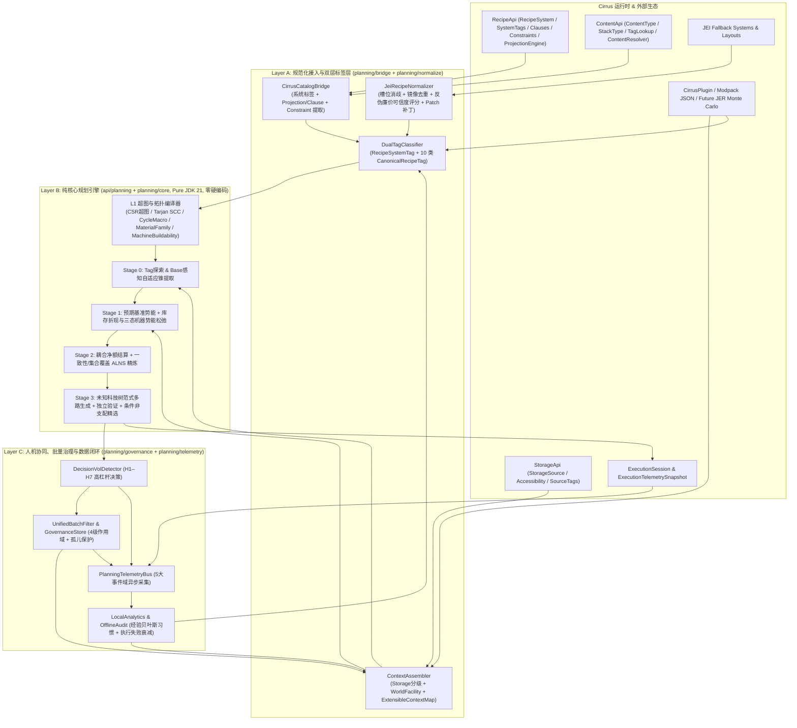
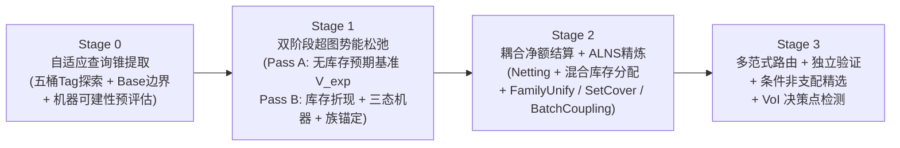
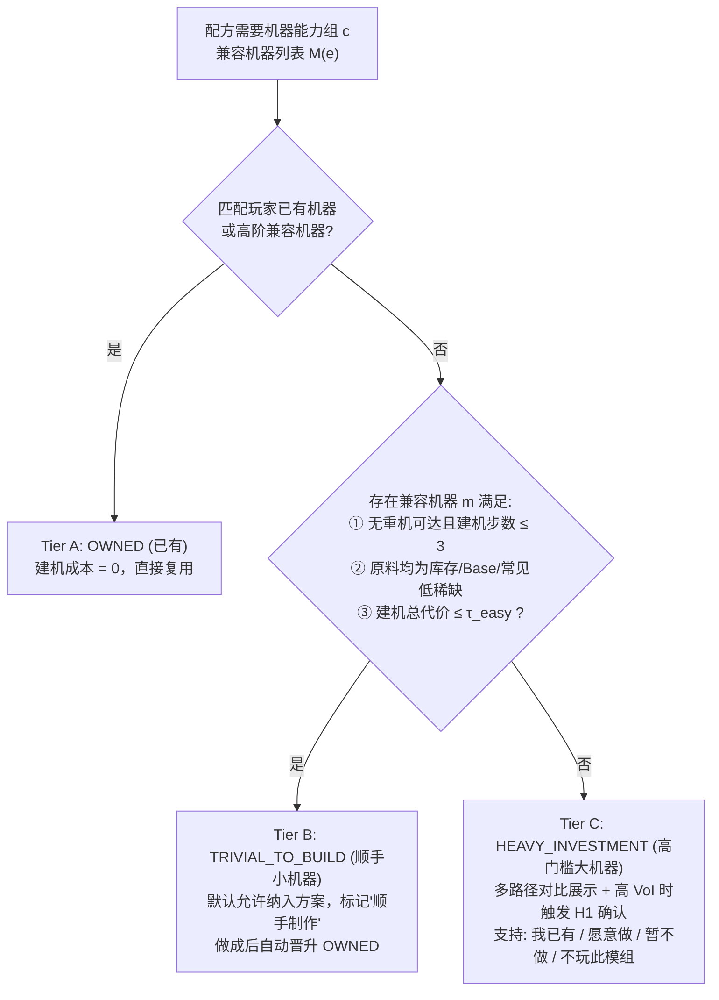

# CalculatorCirrus 路径规划器（Planning v3）完整设计规划与数学建模文档

> **文档状态**：设计定稿（Rev 3.0）  
> **适用范围**：`CalculatorCirrus` 规划模块（`api/planning/**`、`planning/core/**`、`planning/normalize/**`、`planning/bridge/**`、`planning/telemetry/**`）及其与 Cirrus API、JEI、规则系统、执行层与 UI 工作台的协同边界  
> **关联文档**：现行架构参考 [PLANNING.md](./PLANNING.md) · 演进与待办日志 [PLANNING-DEVLOG.md](./PLANNING-DEVLOG.md) · 规则语言参考 [RULES.md](./RULES.md) · 离线实验交接 [HANDOVER.md](../../experiments/quality/HANDOVER.md)

---

## 目录

1. [重做动因：现行 Planning v2 代码级诊断与 v3 设计原则](#1-重做动因现行-planning-v2-代码级诊断与-v3-设计原则)
2. [总体架构与 Cirrus API 深度集成蓝图](#2-总体架构与-cirrus-api-深度集成蓝图)
3. [路径规划问题的完整数学建模](#3-路径规划问题的完整数学建模)
4. [核心自动判别策略：Tag 探索、材料一致性、库存与 Base 边界、务实资源采集](#4-核心自动判别策略tag-探索材料一致性库存与-base-边界务实资源采集)
5. [用户需求驱动：精准预设、阶段价值动态建模与未知科技树多路径输出](#5-用户需求驱动精准预设阶段价值动态建模与未知科技树多路径输出)
6. [通用求解算法流水线（Anytime 相对最优求解器）](#6-通用求解算法流水线anytime-相对最优求解器)
7. [人类辅助决策与上下文补全体系](#7-人类辅助决策与上下文补全体系)
8. [双层配方标签、JEI 配方规范化与统一批量过滤治理](#8-双层配方标签jei-配方规范化与统一批量过滤治理)
9. [可拓展接口体系、用户数据收集与数据分析闭环](#9-可拓展接口体系用户数据收集与数据分析闭环)
10. [迁移路线图、量化验收门禁与专项待办索引](#10-迁移路线图量化验收门禁与专项待办索引)

---

## 1. 重做动因：现行 Planning v2 代码级诊断与 v3 设计原则

### 1.1 对现行 Planning v2（Neon 重写版）的逐项诊断

现行 v2 规划器建立了纯 JDK 21 核心隔离、独立计划验证器（`DefaultPlanVerifier`）与确定性 CSR 图结构等良好工程基础，但在**问题理解、Cirrus API 利用、默认策略质量、人机协同实用性、JEI 失真治理与可拓展性**六个核心维度存在系统性偏差：

| 维度 | 现行 v2 代码事实（痛点定位） | 实际导致的体验/质量后果 |
| :--- | :--- | :--- |
| **1. 与 Cirrus API 严重脱节** | `CirrusCatalogAdapter` 未调用 `RecipeApi.getSystemTags(systemId)`；`extractContentSourceOrThrow` 固定传 `ResolveContext.empty()` 且仅消费 `DurabilityCostClause` 单一子句，丢弃其余 `RecipeClause`、`ProjectionContextOption`、`RecipeConstraint` 与 `MachineConstraint`；`StorageInventorySnapshotAdapter` 将多源 `StorageSource` 压平为单一 `StockLedger`，丢弃 `StorageAccessibility` 与容器标签。 | Cirrus 已建设的大量系统标签、子句变换、容器可达性与执行遥测被闲置；规划核心被迫用字符串猜测弥补信息缺失。 |
| **2. 核心层硬编码词表泛化差** | `DefaultAcquisitionOracle` 内写死 53 个物品表（`naturalBaseTable`）、54 个加工后缀（`processedSuffixes`）与 5 个 Tag ID；`DefaultSystemAdmissionPolicy` 与 `SystemCostTiers` 内直接硬编码 `minecolonies`、`gregtech`、`modern_industrialization`、`allthecompressed`、`securitycraft` 等模组/系统名。 | 在新整合包、魔改包、空岛包、TFC、GregTech 等场景下策略失灵；与 `RecipeClassifier` / `builtin_rules.json` 双轨割裂。 |
| **3. Tag 停止过早 + 无材料一致性** | `ConeExtractor.selectHighFanoutFast` 遇高扇出 Tag 直接按硬编码自然表截断，对命中成员停止向下探索；`Potentials` 按槽位独立贪心选 `bestSlotRep`，无全局材料族变量。 | 常见 Tag 探索不充分；同一计划里可能出现橡木做箱子、桦木做木棍、云杉做拉杆的“拼凑风”路径。 |
| **4. 库存处理极端（死板优先 + 二值悬崖）** | `Netting.settle` 无条件先将全部 `usableStock[u]` 注入 `vec.net[u]`；`Potentials` L152 使用硬阈值 `usableStock[u] >= demandScale ? 1e-4 : prodCost[u]`。 | 手里仅有 1–2 个零碎杂木或珍稀中间品时，可能拆碎整洁路径或胡乱消耗高价值库存；库存略小于需求时又在势能期被完全忽略，无法平滑混合使用。 |
| **5. Base 边界僵硬 + 采集模型不切实际** | `iron_ingot` 等大宗基础锭被归入加工后缀强制展开到底；`AcquisitionKind` 虚设 5 种多模态枚举却只用 2 种，且将 `diamond`、`emerald`、`ancient_debris`、`blaze_rod` 默认列为可采集叶，并将未知无生产者物品兜底当成 `worldGather`。 | 不同整合包的合理止步边界无法表达；高价值/不可采集物与数据缺口被误当成“去挖就行”。 |
| **6. 预设抽象 + 未知科技树处理缺失** | `ObjectivePreset` 仅 5 个拍脑袋线性权重；缺乏“宅家工厂/厌恶跑图”与阶段价值差异；`DefaultPlanningService.probeAlternativeRoute` 仅暴力删 2 步重跑。 | 无法刻画工厂包玩家痛恨跑图的真实偏好；在 ATM10 等多模组并行科技树下，多路线经常塌缩为同一科技线微调，未能把不同科技分支作为多结果呈现。 |
| **7. 人类辅助决策少、错位且重复打扰** | `DecisionPointDetector` 仅 4 类，缺少“已有机器 / 顺手小机器 / 高门槛大机器”分级与模具/Base 确认；多数建议规则默认落 `GuidanceScope.session`。 | 无法通过简洁点选补齐最有用的机器与基地上下文；换一次会话又要重复点，且缺少批量清理垃圾配方的工具。 |
| **8. JEI 失真治理不足 + 数据收集空白** | `JeiRecipeLayoutResolver.addOutputs` 将单槽多候选轮播物品全部当作同时输出；仅靠 `>=4` 输出拆分与正则兜底；`PlanningContext` 为封闭 5 字段 `record`，无插件 SPI，无任何用户行为/制作/机器/执行数据采集与分析闭环。 | “看似超便宜实则做不出/漏条件”的 JEI 伪配方频繁混入推荐；系统无法从用户决策与执行卡点中持续变聪明。 |

### 1.2 Planning v3 六项核心设计原则

1. **核心极简通用，语义由外注入（Domain-Agnostic Core, Cirrus-Native Edge）**：`api/planning` 与 `planning/core` 严格保持纯 JDK 21、零 Minecraft/JEI 依赖、**零模组/物品/英文词缀硬编码**、确定性可验证；所有游戏世界语义通过 Cirrus API 与可拓展 SPI 规范化注入。
2. **相对最优与多项式可控（Practical Near-Optimality under Budget）**：正视最优生产规划的 NP-Hard 本质，用“分层松弛 + 耦合净额 + 一致性局部搜索 + 范式多路生成”在交互预算内给出高质量、严格守恒、可独立验证的相对最优路径集合。
3. **预期成本优先，上下文平滑调节（Expected-First, Context-Informed）**：以“无碎库存干扰的预期经济路线”为锚，让库存（机会成本折现）、材料家族一致性（软切换罚分）、已有机器与 Base 边界自然引导解，不走极端、不产生病态跳变。
4. **未知科技树用“多结果”呈现，真实信息缺口用“低频高杠杆”补齐**：绝不拷问玩家完整科技树；仅围绕真正无法从静态配方推导的高价值上下文（机器保有、Base 边界、非消耗模板、可疑 JEI 配方、家族偏好）提供一次点击、长效复用的辅助决策。
5. **标签平实好用，过滤工具与人机协同合一**：用直观的双层标签（Cirrus 配方系统标签 + 10 类常规化配方标签）取代过粗或过繁的学术分类，并把 JEI 规范化、批量垃圾筛选与交互式人类辅助合并为统一治理流。
6. **默认即可用，越用越懂玩家（Extensible & Data-Driven Loop）**：提供无需配置即符合人类直觉的默认上下文策略，同时建立可扩展 SPI 与本地隐私安全的数据收集/分析引擎，让机器、选路、拉黑与执行遥测反哺规划质量。

---

## 2. 总体架构与 Cirrus API 深度集成蓝图

### 2.1 分层架构总览



### 2.2 Cirrus API 深度集成契约表

Planning v3 不再绕开 Cirrus API 自建平行语义，而是逐项深度消费并补齐以下接口：

| Cirrus 既有模块 / API | 现行 v2 使用情况 | Planning v3 深度集成方案 |
| :--- | :--- | :--- |
| `RecipeApi.getSystemTags(Namespace)` / `RecipeSystemTagRegister` | **完全未调用** | 扩展标准 `cirrus:system/*` 三维系统标签；桥接层直接读取并传给核心，替代 `DefaultSystemAdmissionPolicy` 与 `SystemCostTiers` 中的全部硬编码模组名。 |
| `RecipeProjection` / `ProjectionEngine` / `ProjectionContextOption` / `ClauseSet` | 仅在无 `RoutingRecipeView` 时调用空上下文，且仅读 `DurabilityCostClause` | 构建 `CalculatorProjectionContext`（注入当前玩家/阶段配置），完整消费 `DurabilityCostClause`、`FluidContainerUnpackClause`、`GuaranteedOutputClause`、`ResolvePolicyClause` 及模组扩展子句（时间 `TimeValue`、能量 `EnergyValue`、温度/电压等）。 |
| `RecipeSystem.getRecipeConstraint(R)` / `MachineEntry` / `MachineConstraint` | 几乎未消费约束语义；机器仅提 itemId 字符串 | 抽取结构化约束特征（如最低机器等级、是否支持向下兼容、是否为黑盒 `OPAQUE_CONSTRAINT`）；使用 `MachineMatcher` 判定玩家已有高阶机器对低阶配方的能力覆盖。 |
| `RecipeSystem.routingHints(R)` / `RecipeSystem.getData(SystemDataType)` | 仅读了 `usePolicy` 与 `recycling` 角色 | 完整消费 `roles`、`penalty`、`reasonKey` 以及系统级扩展元数据（`SystemDataType`，如默认单批耗时、并行上限、自动化能力声明）。 |
| `ContentApi` / `TagType` / `TagLookup` / `ContentResolver` | 仅用于简单展开为候选列表 | 利用 `TagLookup` 保留完整 Tag 层级与反向归属索引，支撑 Tag 语义画像与同态派生链识别；利用 `fluidContainer` / `itemContainer` 识别容器装卸配方。 |
| `StorageApi` / `StorageSource` / `StorageAccessibility` / `TagKey<StorageSource>` | 压平丢弃了全部来源信息 | 按来源分层保留库存：`inventory_hand`（随身）、`storage_network`（AE2/RS 等即时网络）、`storage_nearby`（附近容器）、`storage_remote`（需指引前往，带 `StorageAccessibility` 惩罚），差异化设定库存机会成本 $\alpha_{\text{opp}}$ 与取用摩擦 $\beta_{\text{pick}}$。 |
| `ExecutionSession` / `ExecutionTelemetrySnapshot` / `PauseReason` | 单向翻译导出，无回流 | 订阅执行完成、步时速率 `ratePerSecond`、暂停与失败原因 `PauseReason`，回流至 `PlanningTelemetryBus`，驱动步时校准与可疑配方可信度衰减。 |
| `api/recipe/rule/`（v3 统一规则引擎） | 仅在 `ClassifierVerdictBridge` 静态调用一次 | 将规划器批量筛选过滤工具、人类决策固化规则、整合包治理规则统一构建在 `RuleCondition` / `RuleSpec` 之上，实现一套条件语言贯穿建图、过滤与规划。 |

### 2.3 纯核心隔离红线（保留并升级）

1. `api/planning/**` 与 `planning/core/**` 仅依赖 JDK 21 标准库（维持 `javac --release 21 -Xlint:all -Werror` 独立编译门禁）。
2. **新增零词表静态门禁**：`planning/core/**` 内禁止出现任何具体 Minecraft 物品名、模组命名空间（如 `minecraft:oak_log`、`mekanism`、`gregtech`、`minecolonies`）或英文加工词缀集合（如 `_ingot`、`_plate`）。所有此类领域知识必须外置到 `assets/data` 规则包、Cirrus 系统标签或插件适配器中。
3. **确定性不变式**：相同输入快照 + 相同上下文 + 相同预算下，核心求解器跨次、跨 JVM 输出逐字节一致的计划集合与验证证书。

---

## 3. 路径规划问题的完整数学建模

### 3.1 生产超图与符号定义

定义编译后的开放世界生产超图：

$$\mathcal{H} = \big(V,\; E,\; \mathcal{T},\; \mathcal{M},\; \mathcal{C}_{\text{cap}},\; \mathcal{F},\; \mathcal{K}_{\text{macro}}\big)$$

- **$V$**：规范化资源节点集合（物品、流体、抽象能量/值类载体，经 `ResourceKey = (contentType, resourceId, variantHash)` 唯一标识）。
- **$E$**：规范化确定性配方超边集合。每条配方 $e \in E$ 包含：
  - 系统标识 $\text{sys}(e)$、系统标签集合 $\Sigma_{\text{sys}}(e)$、常规化配方标签集合 $\Sigma_{\text{rec}}(e)$、结构可信度 $\phi(e) \in [0, 1]$；
  - 输入槽序列 $S_{\text{in}}(e)$：每个槽位 $s \in S_{\text{in}}(e)$ 具有需求量 $a_{e,s} \in \mathbb{Z}_{>0}$、可选 Tag 标识 $\tau(s) \in \mathcal{T} \cup \{\bot\}$、以及合法候选资源集合 $C(s) \subseteq V$；
  - 确定性产出集合 $O(e) = \{(v, b_{e,v}) \mid b_{e,v} \in \mathbb{Z}_{>0}\}$；
  - 非消耗催化剂/模板槽集合 $S_{\text{cat}}(e)$（每槽需至少持有 $q_{e,c} \ge 1$ 份在场，执行后不净消耗，或按耐久折损折算等效消耗）；
  - 机器能力需求 $\text{cap}(e) \in \mathcal{C}_{\text{cap}} \cup \{\bot\}$ 及兼容机器集合 $\mathcal{M}(e) \subseteq \mathcal{M}$。
- **$\mathcal{F}$**：由图同态派生链与本体先验归纳得到的材料族集合（例如同一木材/石材/基础合金派生族），记 $\text{fam}(v) \subseteq \mathcal{F}$。
- **$\mathcal{K}_{\text{macro}}$**：由 Tarjan SCC 挖掘出的有效净正产出循环宏集合（再生催化/自增殖闭环），每条宏 $\kappa \in \mathcal{K}_{\text{macro}}$ 带有工作种子需求 $w^{\text{seed}}_{\kappa,v} \ge 0$ 与单轮净增量 $\Delta_{\kappa,v} \in \mathbb{Z}$。

### 3.2 决策变量

给定目标需求向量 $d \in \mathbb{Z}_{\ge 0}^{|V|}$ 与规划上下文 $\mathcal{X}$（含分层库存 $I_{v,\ell}$、设施快照 $\mathcal{M}_{\text{owned}}$、自动产线 $L$、Base 边界 $B$、允许采集集 $V_{\text{acq}}$、人机规则 $\mathcal{R}$）：

| 变量 | 域 | 物理含义 |
| :--- | :--- | :--- |
| $x_e$ | $\mathbb{Z}_{\ge 0}$ | 配方 $e \in E$ 的执行批次数 |
| $x_\kappa$ | $\mathbb{Z}_{\ge 0}$ | 循环宏 $\kappa \in \mathcal{K}_{\text{macro}}$ 的迭代轮数 |
| $y_{e,s,v}$ | $\mathbb{Z}_{\ge 0}$ | 配方 $e$ 的输入槽 $s$ 分配给候选资源 $v \in C(s)$ 的总数量（允许同一槽跨批次平滑混合不同来源/库存） |
| $u^{\text{inv}}_{v,\ell}$ | $\mathbb{Z}_{\ge 0} \cap [0, I_{v,\ell}]$ | 从库存层级 $\ell$（随身/ME网络/近处/远处）取用资源 $v$ 的数量 |
| $u^{\text{line}}_{v}$ | $\mathbb{Z}_{\ge 0}$ | 从已有自动化产线 $L_v$ 直接拉取的资源数量 |
| $u^{\text{base}}_{v}$ | $\mathbb{Z}_{\ge 0}$ | 从 Base 边界供给（基地大宗常备）获取的数量 |
| $u^{\text{gather}}_{v}$ | $\mathbb{Z}_{\ge 0}$ | 需要玩家手动外出采集获取的数量 |
| $z_m$ | $\{0, 1\}$ | 是否在本计划中**新建/制备**机器 $m \in \mathcal{M} \setminus \mathcal{M}_{\text{owned}}$ |
| $\zeta_{v,\text{cat}}$ | $\{0, 1\}$ | 是否需要为非消耗催化剂/模板 $v$ 准备 1 份在场实体 |
| $w_{\tau, f}$ | $\{0, 1\}$ | Tag 类别 $\tau$ 下是否激活了材料族 $f \in \mathcal{F}$ |

### 3.3 严格可行性约束

1. **槽位匹配守恒（Slot Binding Conservation）**：
   $$\forall e \in E,\ \forall s \in S_{\text{in}}(e):\quad \sum_{v \in C(s)} y_{e,s,v} = a_{e,s} \cdot x_e$$
2. **全图整数质量守恒（Exact Integer Mass Conservation，含递归建机与循环宏）**：
   $$\forall v \in V:\quad \sum_{\ell} u^{\text{inv}}_{v,\ell} + u^{\text{line}}_v + u^{\text{base}}_v + u^{\text{gather}}_v + \sum_{e \in E} b_{e,v} x_e + \sum_{\kappa \in \mathcal{K}_{\text{macro}}} \Delta_{\kappa,v} x_\kappa \;\ge\; d_v + \sum_{e \in E}\sum_{s: v \in C(s)} y_{e,s,v} + \sum_{m: \text{item}(m)=v} z_m$$
3. **来源准入门禁（Admission Gates — 杜绝高价值非法采集）**：
   $$\begin{aligned}
   v \notin V_{\text{line}} &\implies u^{\text{line}}_v = 0 \\
   v \notin B(\mathcal{X}) &\implies u^{\text{base}}_v = 0 \\
   v \notin V_{\text{manual\_gather}}(\mathcal{X}) &\implies u^{\text{gather}}_v = 0
   \end{aligned}$$
4. **机器能力覆盖与向下兼容约束（Machine Capability Coverage）**：
   $$\forall e \in E:\quad x_e > 0 \implies \big(\text{cap}(e) = \bot\big) \lor \Big(\exists m \in \mathcal{M}(e):\; m \in \mathcal{M}_{\text{owned}}^{\text{compat}} \lor z_m = 1\Big)$$
   其中 $\mathcal{M}_{\text{owned}}^{\text{compat}}$ 由 Cirrus `MachineMatcher` / `MachineConstraint` 计算（自动覆盖高阶兼容低阶机器）。
5. **催化剂与循环种子在场约束（Catalyst & Bootstrap Presence）**：
   任何被激活配方所需非消耗催化剂、或激活循环宏 $\kappa$ 所需初始种子 $w^{\text{seed}}_{\kappa,v}$，必须满足在对应步骤执行前的瞬时净存量 $\ge$ 所需在场量（且不得由该循环自身凭空产生）。
6. **因果拓扑无环与严格两池 FIFO 副产守恒**：
   存在活跃步骤的拓扑序 $\pi$，使任意步骤消耗的中间品、机器与种子均在其之前就绪；计划内产生的剩余副产品严格隔离在副产池中按 FIFO 核算，禁止制造无意义的 A→B→A 往返环。
7. **材料族激活指示约束**：
   $$\forall (e,s,v) \text{ with } \tau(s) \neq \bot,\ f \in \text{fam}(v):\quad y_{e,s,v} > 0 \implies w_{\tau(s), f} = 1$$
8. **人类硬规则约束**：所有作用域生效的 `HARD_BAN`（禁用配方/系统/机器/资源）强制对应变量为 0；`HARD_PIN` 强制目标资源优先采用钉选配方或 Tag 成员。

### 3.4 复杂度结论（NP-Hard 归约说明）

**命题**：即使在无循环（DAG）、无概率、无副产的受限实例下，求上述规划问题的全局最优解仍是 **NP-Hard**。

- **归约证明概要（来自 Weighted Set Cover）**：给定集合覆盖实例 $(U, \mathcal{S}, c)$，令每个元素 $u_i \in U$ 为需求量 1 的目标资源，每个子集 $S_j \in \mathcal{S}$ 对应一台未拥有机器 $m_j$（建机成本 $c_j$），为每个 $u_i \in S_j$ 构造零料耗配方 $\varnothing \xrightarrow{m_j} u_i$。最小化总成本恰好等价于选出总代价最小的机器子集覆盖全部 $u_i \in U$。
- **叠加复杂度来源**：除了共享机器的固定费用覆盖（Fixed-Charge Set Cover），问题还同时包含整数批次耦合（Integer Knapsack / Coupling）、多槽材料族一致性（Facility Location / Color-Saving Steiner Tree）以及库存分段机会成本。
- **工程推论**：任何试图在 ATM10（30 万+ 配方、8 万+ 物品）上求全局精确 MILP 最优的方案都无法满足交互级时延；必须构建**具有明确近似结构、保证严格可行性、利用超图稀疏性（中位生产者数仅为 2，44% 物品为 0 或 1 生产者）的 Anytime 多阶段相对最优求解器**。

### 3.5 双层解耦目标函数：物理成本向量 × 软语义决策标量

规划器严格区分**向用户如实展示且受验证器核对的物理指标向量**，以及**仅用于搜索排序与偏好权衡的软语义目标**（延续并深化“软规则零泄漏进真实成本”的优秀原则）：

1. **6 维可观测物理成本向量 $\mathbf{C}(P) \in \mathbb{R}_{\ge 0}^6$**（供前端卡片展示、成本拆解与验证器核验）：
   $$\mathbf{C}(P) = \Big(\underbrace{H_{\text{craft}}}_{\text{基地内人工操作秒}},\; \underbrace{H_{\text{trip}}}_{\text{外出跑图采集秒}},\; \underbrace{W_{\text{passive}}}_{\text{被动等待秒}},\; \underbrace{K_{\text{mach}}}_{\text{新建机器投入}},\; \underbrace{M_{\text{scarcity}}}_{\text{净原料稀缺消耗}},\; \underbrace{F_{\text{steps}}}_{\text{步骤与操作复杂度}}\Big)$$
   > **相对 v2 的关键改进**：将“外出跑图采集时间 $H_{\text{trip}}$”从混在一起的 `humanActiveSeconds` 中**独立拆成一等维度**！这让“宅家工厂/厌恶跑图”预设可以直接且透明地对 $H_{\text{trip}}$ 施加重权重，同时用户一眼就能看清某条方案是否需要出门跑图。

2. **综合决策目标函数 $J_{\mathcal{P}, \mathcal{X}}(P)$**（标量化搜索目标，越小越优）：
   $$J_{\mathcal{P}, \mathcal{X}}(P) = \underbrace{\mathbf{w}(\mathcal{P}, \boldsymbol{\theta}_{\text{stage}}, Q) \cdot \mathbf{C}(P)}_{\text{阶段与预设加权物理成本}} + \underbrace{C_{\text{inv}}^{\text{eff}}(P)}_{\text{库存机会成本与拆单摩擦}} + \underbrace{C_{\text{cons}}(P)}_{\text{同类材料一致性罚分}} + \underbrace{C_{\text{trust}}(P)}_{\text{标签与JEI可信度罚分}} + \underbrace{C_{\text{soft}}(P)}_{\text{人机软规则与插件/习惯偏置}}$$

   其中：
   - 物理成本项均按真实配方、设备、采集量严格可核对累加；
   - $C_{\text{trust}}(P) = \sum_{e: x_e > 0} \big(\text{tagPenalty}(\Sigma_{\text{rec}}(e)) + \gamma_{\text{jei}} \cdot \max(0, 1 - \phi(e)) \cdot \text{baseScale}(e)\big)$，确保可疑 JEI 配方、换色、变体互换与拆解回收不会仅凭“账面便宜”就压倒正常生产路线；
   - $C_{\text{soft}}(P)$ 聚合用户软偏好规则、第三方 `ScoringContributor` 与本地习惯模型的有界偏置。

---

## 4. 核心自动判别策略：Tag 探索、材料一致性、库存与 Base 边界、务实资源采集

### 4.1 Tag 内容物自动识别与五桶有界探索（Never Stop Blindly at a Tag）

实证统计表明（[STATS.md](../../chain-review/analytics/STATS.md)），跨 22 个整合包有 **25.5%** 的配方输入槽位是 Tag / 多候选槽位，是寻路质量与算力预算的最大决定因素。

#### 4.1.1 建图期 Tag 语义自动画像（零硬编码）

在 L1 图编译阶段，对每个驻留的 Tag/OR 集合 $T$ 自动计算结构画像 `TagProfile(T)`：

1. **成员规模与生产性分布**：总成员数 $|T|$、可生产成员数 $|T_{\text{prod}}|$、允许采集成员数 $|T_{\text{acq}}|$、Base 成员数 $|T_{\text{base}}|$。
2. **Tag 同态派生链检测（Tag Homomorphism Discovery）**：
   若存在上游 Tag $T'$ 与高频同构配方模板 $\tau$，使得 $T$ 中超过 $\ge 50\%$ 的成员 $v$ 均满足存在单主料配方 $u \xrightarrow{\tau} v$（其中 $u \in T'$），则建立有向同态边：
   $$T' \xrightarrow{\;\tau\;} T$$
   *例*：`#minecraft:logs` $\to$ `#minecraft:planks` $\to$ 派生木制品；`#c:raw_materials` $\to$ `#c:ingots`；完全由图结构自动识别，无需任何英文木头/金属词表！
3. **等价性分类**：
   - `UNIFORM_EQUIVALENT`（同质兼容 Tag，如不同模组的铜锭 `#c:ingots/copper`，成员势能接近、同属一族）；
   - `MULTI_FAMILY_SYMMETRIC`（多族对称 Tag，如 `#minecraft:logs`、`#minecraft:planks`、`#c:dyes`，内部含多个平行材料族，需要探索与一致性锁定）；
   - `HETEROGENEOUS_BROAD`（宽泛异构 Tag，如 `#c:gems`、`#c:foods`、`#c:storage_blocks`，成员价值跨度可达数个数量级，**严禁按字典序盲取或见成员即止步**）。

#### 4.1.2 查询期五桶有界探索算法（Five-Bucket Bounded Exploration）

当 Stage 0 锥提取或 Stage 1 势能松弛遇到任意 Tag 槽 $s$（$|C(s)| > \theta_{\text{small}}$，默认 $\theta_{\text{small}} = 8$）时，不再遇到所谓“自然物”就停止探索，而是对 $C(s)$ 分配随深度 $d$ 衰减的总配额 $K(d) = \max(4, \lfloor 16 \cdot 0.72^d \rfloor)$，并按 **5 个正交语义桶**收集探索候选：

| 桶编号 | 语义桶 | 选择判据 | 默认配额占比 | 解决什么问题 |
| :-: | :--- | :--- | :-: | :--- |
| **B1** | **用户与会话锚点桶** | 用户钉选/偏好成员 + 当前会话已激活材料族 $\mathcal{F}_{\text{active}}$ 匹配成员 | 必保（上限 3） | 优先继承用户偏好（如设定了橡木后直接带上橡木系） |
| **B2** | **有效供给与高覆盖库存桶** | 已有自动产线 $L_v$、Base 成员 $B$、或满足高库存覆盖比 $\min(1, I_v / \text{req}_s) \ge 0.25$ 的成员 | 25%（上限 3） | 参考有效库存与基地现成产线，不被 1 个零碎物品占满名额 |
| **B3** | **向内深探可生产代表桶** | 对 $v \in C(s) \cap V_{\text{prod}}$，**主动向 Tag 成员内部再探 1–2 层生产链**，按建图期预计算的下界基准势能 $\underline{P}_0(v)$ 选出跨不同材料族的最廉代表 | 35%（上限 4） | **核心突破**：遇到 `#minecraft:planks` / `#c:plates/iron` 等加工型 Tag 时主动穿透展开其上游生产链，而不是停在 Tag 表面 |
| **B4** | **合法可采集代表桶** | 仅限 $v \in C(s) \cap V_{\text{acq}}$（**高价值禁采项绝不入选**），按预期采集代价由低到高取跨族代表 | 20%（上限 3） | 在允许采集的前提下，自动找到最便宜且合法的采集源（如花源染料优先于矿源染料） |
| **B5** | **跨模组/低扇出多样性探针桶** | 从尚未被 B1–B4 覆盖的命名空间/材料族中，按消费广度最高 + 生产者非垃圾度最高的成员补抽探针 | 20%（上限 2） | 防止漏掉整合包特有高性价比路线（如空岛/魔改特产材料） |

- **惰性深化机制（Lazy Tag Deepening）**：若首轮配额 $K(d)$ 下某 Tag 槽所有已探候选均不可达，或最优候选被迫使用 `DISCOURAGED / LAST_RESORT / suspicious_jei` 配方，求解器自动触发二阶段深化（配额倍增 $K \leftarrow \min(|C(s)|, 3K)$，最多 2 次），确保质量不因初次探索截断而受损。

---

### 4.2 同类材料稳定一致性模型（软约束，可被显著优势打破）

#### 4.2.1 无词表材料族自动归纳（Lineage-Based Family Induction）

对每个资源 $v \in V$，定义其**材料族谱集合** $\text{fam}(v)$，由两类完全通用的信号在编译期合成：

1. **单主干派生传播（Primary Derivation Lineage）**：
   若配方 $e$ 属于 `normal_production` 或 `cutting`，且其主要消耗输入槽 $s^*$ 唯一决定形态转换（例如 `1 oak_log -> 4 oak_planks`、`2 oak_planks -> 4 stick`、或满足 Tag 同态边 $T' \xrightarrow{\tau} T$），则 $v$ 继承上游根资源 $r_{\text{root}}$ 作为其主导族标记（`fam:root/<r_root>`）。
   - 对于通用中间品（如 `minecraft:stick` 可由所有木板制造），其自身不锁定单一族，但**选择某条生产配方 `oak_planks -> stick` 时，该步骤会携带输入所激活的族 `fam:oak`**！
   - 当用户把 `oak_log` 设为 Base / 首选可获取资源，或者计划中某个上游步骤已经采购/使用了 `oak_log`，族 `fam:oak` 自动成为活跃锚点族。
2. **上下文互换本体族补充（可选）**：对无明显单源派生关系的变体集（如 16 种颜色、同族石材），借助 `ontology` 无监督上下文余弦聚类结果（见 [HANDOVER.md](../../experiments/quality/HANDOVER.md) §4.2）补充对称族 ID。

#### 4.2.2 一致性软代价数学公式

对一条候选计划 $P$，记 $\mathcal{T}_{\text{multi}}(P)$ 为计划中实际用到的全部多族 Tag 槽集合，$\mathcal{F}_\tau(P)$ 为 Tag $\tau$（及其同态派生链）下实际被选用的不同材料族集合，$\mathcal{F}_{\text{anchor}}(\mathcal{X})$ 为用户显式偏好、Base 边界与已有自动化产线所锚定的材料族集合。定义**一致性成本**：

$$C_{\text{cons}}(P) = \lambda_{\text{switch}} \cdot \sum_{\tau \in \mathcal{T}_{\text{multi}}(P)} \max\!\Big(0,\; |\mathcal{F}_\tau(P)| - 1\Big) \;+\; \lambda_{\text{drift}} \cdot \sum_{f \in \mathcal{F}_{\text{used}}(P) \setminus \mathcal{F}_{\text{anchor}}(\mathcal{X})} \psi(f)$$

其中：
- **$\lambda_{\text{switch}}$（计划内混料切换惩罚，默认等价约 8–12 秒人工摩擦）**：只要同计划在多处用到木头/木板/木棍，统一用橡木只需支付 0；混用橡木+桦木+云杉则需支付 $2\lambda_{\text{switch}}$。
- **$\lambda_{\text{drift}}$（偏离锚点族的轻度漂移惩罚，默认等价约 3–5 秒人工摩擦）**：若玩家已将橡木设为可获取资源/Base，沿用橡木做木板、木棍、箱子零罚分；改用云杉需支付少量漂移罚分 $\lambda_{\text{drift}}$。
- **非绝对性保证**：由于 $\lambda_{\text{switch}}, \lambda_{\text{drift}}$ 均为有限软代价，一旦另一材料族带来超过罚分的真实净收益（如手里有 64 个桦木板足够做完全部木棍、或某特产竹子/模组木头产量显著更高），规划器会**理性打破一致性**选择更优路线！
- **确定性稳定破平（Stable Tie-Breaking）**：当多个同族候选成本完全相等时，采用稳定排序键 `(isAnchorFamily, userHistoricalAffinity, baseSupplyRank, tagMemberCanonicalOrder)`，保证同一存档内跨次查询结果高度稳定，不会今天选橡木、明天选金合欢。

---

### 4.3 库存策略：预期优先、机会成本参考与自然混合使用

#### 4.3.1 核心思想与经济模型

摒弃 v2“库存强制先扣光（等效 0 价）+ 势能期二值悬崖”的僵化处理。在 Planning v3 中，**先计算无库存干扰的预期基准成本 $V_{\text{exp}}(v)$**，再把库存视为**有经济折现但非免费的有限供给通道**。

设资源 $v$ 在库存层级 $\ell \in \{\text{hand}, \text{network}, \text{nearby}, \text{remote}\}$ 上的可用数量为 $I_{v,\ell}$，其预期单位替代成本（无库存全链路基准势能）为 $V_{\text{exp}}(v)$。在本计划中从库存消耗 $q = \sum_\ell u^{\text{inv}}_{v,\ell}$ 单位资源 $v$，而该节点总有效需求为 $D_v$ 时，其**有效库存成本**定义为：

$$C_{\text{inv}}^{\text{eff}}(v, \{u^{\text{inv}}_{v,\ell}\}) = \sum_{\ell} \Big[\;\underbrace{\alpha_{\text{opp}}(v, \ell) \cdot V_{\text{exp}}(v) \cdot u^{\text{inv}}_{v,\ell}}_{\text{机会成本（重补价值折现）}} + \underbrace{\mathbb{I}[u^{\text{inv}}_{v,\ell} > 0] \cdot \beta_{\text{pick}}(\ell)}_{\text{容器取用固定摩擦}}\;\Big] + \underbrace{\mathbb{I}[0 < q < D_v] \cdot \gamma_{\text{split}} \cdot \left(1 - \frac{q}{D_v}\right)^{\!p}}_{\text{零碎混合拆单惩罚}}$$

#### 4.3.2 参数物理含义与默认校准值

| 参数 | 物理含义 | 默认推荐值（`conservative_expected_first`） | 行为效果 |
| :--- | :--- | :--- | :--- |
| $\alpha_{\text{opp}}(v, \ell)$ | 机会成本折现率（库存相对现做的经济成本比） | 随身背包 `0.35` · ME/RS 网络 `0.30` · 附近箱子 `0.45` · 远端容器 `0.65`；对高稀缺中间品再乘保护因子 `min(1.0, +0.20)` | 既体现“库存确实更值钱（省下 55%–70% 代价）”，又保证**绝不会拿库存里的 1 颗钻石去替代圆石/铁锭**（因为 $0.55 V_{\text{exp}}(\text{diamond}) \gg V_{\text{exp}}(\text{iron})$）。 |
| $\beta_{\text{pick}}(\ell)$ | 每开启一次库存取用的固定认知/操作摩擦 | 随身 `1.0s` · ME/RS `1.5s` · 附近箱子 `4.0s` · 远端容器 `15.0s` | 阻止为了拿箱子里 1 个便宜基础料而多跑一趟或把计划拆乱。 |
| $\gamma_{\text{split}}, p$ | 局部混合拆单的碎片整理成本（默认 $p = 1.5$） | $\gamma_{\text{split}} = 6.0\text{s}$ | 当库存仅覆盖需求的 3%（如缺 64 只有 2 个杂木），$(1 - 0.03)^{1.5} \approx 0.955$，高拆单惩罚 + 家族切换惩罚会自动放弃这 2 个零碎库存，输出干净的纯生产方案；当库存覆盖 60%（如 40 个同族木板）或覆盖高价值复杂中间品（如 3 个高阶处理器，省下 $(1-\alpha) V_{\text{exp}} \cdot q \gg \gamma_{\text{split}}$）时，**自然触发“库存 + 预期生产”混合使用**！ |

#### 4.3.3 数学上的分段混合决策（支持库存 + 生产并存）

在 Stage 1 与 Stage 2 中，每个节点 $v$ 的单位有效成本函数不再是二值阶跃，而是**连续可微近似的分段期望成本**：

$$\hat{V}_{\text{blend}}(v, D_v) = \min\Big\{\; V_{\text{exp}}(v),\;\; \frac{C_{\text{inv}}^{\text{eff}}(v, q^*) + (D_v - q^*) \cdot V_{\text{exp}}(v)}{D_v} \;\Big\},\quad q^* = \min(I_v, D_v)$$

- **彻底消除 v2 的二值悬崖**（原来 $I_v = 9, D_v = 10$ 时库存直接被无视，现在平滑地按 $9$ 个折现 + $1$ 个现做评估，并自动扣除拆单摩擦）；
- **在 Tag 槽上支持同槽跨源混合**：若某 Tag 槽需要 $N$ 个单位，且玩家在首选锚点族有 $q < N$ 个库存，Netting 允许先消费 $q$ 个同族库存，再对剩余 $N - q$ 个执行常规生产，无需拆成两条互相打架的路线！
- **对目标自身**：仍遵循“规划目标本身默认排除目标现有库存（避免玩家想做 10 个漏斗，因为手里有 10 个就直接返回空计划）”，同时可在请求选项中显式开启 `deductTargetStock`。

---

### 4.4 基础材料（Base）边界设计（包无关、可分层、可穿透）

不同整合包的 Base 截然不同（原版包停在原木/铁锭/红石；Create 包停在安山合金/黄铜锭/圆石；ATM10 中期停在各类金属锭/基础精华；GregTech 包随时代演进停在蒸汽青铜→钢→铝→聚乙烯）。Planning v3 建立**三层可组合 Base 边界体系**，绝不写死假设：

#### 4.4.1 Base 的精确定义与防失真定价

- **语义**：资源 $v \in B(\mathcal{X})$ 表示“单次制作规划默认在此止步，视为基地大宗常规输入，不展开其上游矿产/农产/基础化工产线”。
- **目标豁免原则**：若用户查询的**目标本身**就在 $B(\mathcal{X})$ 中（例如玩家专门查 `iron_ingot` 怎么产），规划器自动对该目标临时解除 Base 止步，正常展开其上游产线！
- **防免费失真定价**：Base 资源**不是 0 成本**！每个 Base 资源拥有相对标价：
  $$V_{\text{base}}(v) = \text{clip}\big(\eta_{\text{base}} \cdot V_{\text{exp}}^{\text{raw}}(v),\; c_{\min},\; c_{\max}\big) \quad (\text{默认 } \eta_{\text{base}} \approx 0.45)$$
  即使铁锭与金锭同时被设为 Base，它们仍保持 $V_{\text{base}}(\text{iron}) < V_{\text{base}}(\text{gold})$ 的自然价值序，避免规划器因设为 Base 就乱拿金锭替代铁锭。

#### 4.4.2 三层 Base 边界合成机制

$$B(\mathcal{X}) = \big(B_{\text{pack}}(\text{stage}) \cup B_{\text{inferred}}(\mathcal{H}, \mathcal{X}) \cup B_{\text{user\_add}}\big) \setminus B_{\text{user\_expand}}$$

1. **Layer 1 — 整合包/插件声明层 $B_{\text{pack}}$**：
   通过数据包 JSON 或 `BaseBoundaryProvider` SPI 按 **Tag + 阶段**声明（如 `stage=mid` 时 `#c:ingots/iron`、`#c:ingots/copper`、`#minecraft:logs` 纳入 Base）。内置提供轻量通用默认集（通过标准公共 Tag 匹配，不依赖模组硬编码）。
2. **Layer 2 — 纯图论 + 运行态自动推断层 $B_{\text{inferred}}$（零词表冷启动）**：
   即使全新未知整合包未提供任何配置，也能基于 3 个客观信号自动识别候选 Base（默认作为“弱 Base / 建议止步点”）：
   - **图枢纽产线终点判据**：某资源 $v$ 消费出度极高（位于包内前 5% 高扇出消费枢纽）、拓扑层深浅（$\text{tier}(v) \le 2$），且其最优生产配方属于 `cirrus:system/cooking`、`cirrus:system/ore_processing` 或 `cirrus:system/resource_gen`（即典型的“矿产/农产基础产线终点”，如铁锭、玻璃、塑料）；
   - **玩家大宗常备存量信号**：在玩家网络存储/箱子中存量超过大宗阈值（如 $I_v \ge 256$）且具有较高使用频次；
   - **已有自动化产线**：凡挂接了 `AutomatedLine` 的资源自动具备 Base 止步能力（记为 `LinePullStep`）。
3. **Layer 3 — 玩家世界级覆盖与一键穿透（$B_{\text{user\_add}}, B_{\text{user\_expand}}$）**：
   在规划树/流程图上，玩家右键任意节点即可切换 **“在此止步（设为本存档 Base）”** 或 **“展开上游（取消此物 Base）”**，立刻重算并持久化。

---

### 4.5 务实资源采集设计 & JER 蒙特卡洛专项预留

#### 4.5.1 朴素实际的 2+1 采集分类（取消多模态花架子）

删除 v2 中华而不实的 5 种 `AcquisitionKind`（`worldGather / passiveFarm / villagerTrade / dimensionLoot / playerDeclaredFree`），回归玩家真实认知，仅保留清晰的 **2+1 模型**：

| 状态/类别 | 枚举值 | 直观语义 | 典型场景 |
| :--- | :--- | :--- | :--- |
| **无需跑图（基地供给）** | `baseSupply` | 玩家在基地内直接拿到或自动产出，**$H_{\text{trip}} = 0$** | Base 边界大宗料、自动化产线、无限水、玩家声明的基地农场/刷石机 |
| **需要手动采集** | `manualGather` | 需要玩家手动去挖掘、砍伐、采集或外出获取，计入 **$H_{\text{trip}} > 0$** | 原木、圆石、沙子、常见花卉/作物、未设为 Base 的基础原矿 |
| **禁止作为采集源** | `forbidden`（空值） | **直接禁止当作采集叶！必须通过配方生产或由玩家显式提供库存/Base** | 高价值稀有物（钻石、下界合金、龙蛋、下界之星、烈焰棒等）、一切有合法生产链的加工中间品、未解析数据缺口 |

#### 4.5.2 高价值与不可采集物的通用直接禁止规则

不搞复杂特殊化！是否允许某资源 $v$ 作为 `manualGather` 采集叶，遵循确定性 4 步漏斗：

1. **用户/规则显式覆盖优先**：若用户设为 `Base` / `自动产线` → `baseSupply`；若用户禁用采集 → `forbidden`；若用户显式允许采集并给开销 → `manualGather`。
2. **高价值 / 不可采集标签直禁**：若 $v$ 命中高价值/非采集 Tag（如整合包或默认数据包定义的 `#cirrus:non_gatherable` / `#cirrus:rare_valuable`），**直接返回 `forbidden`**！绝不给它编造采集秒数。
3. **加工产物与数据缺口直禁**：
   - 若 $v$ 在图中存在正常生产配方（非 `junk_or_duplicate` / `recycling` / 纯压缩拆包），默认**不允许**当采集叶（只能走生产、库存或 Base）；
   - 若 $v$ 属于 `unresolvedOutputs`（原生配方解析失败导致的伪叶子），标记为 `DATA_GAP` 诊断状态，**严禁伪装成可采集**，防止给玩家开出无法实现的空头支票。
4. **合法无生产者自然叶的朴素估算**：
   仅对剩余真正无生产者的普通自然叶，给出一期轻量估算（区分“随手地表常见” vs “需专门跑一趟”两档朴素系数），并严格把时间记入 $H_{\text{trip}}$，方便工厂包偏好直接压制。

#### 4.5.3 `[TODO-PLAN-MC-01]` JER 蒙特卡洛模拟预留接口

为后续专项设计的**类 JustEnoughResources（JER）世界资源获取蒙特卡洛模拟**在 `api/planning/context` 中预留干净的只读估算 SPI（一期由轻量规则实现，二期无痛插拔，已同步登记至 [PLANNING-DEVLOG.md](./PLANNING-DEVLOG.md)）：

```java
public interface AcquisitionEstimatorSpi {
    String estimatorId();
    int priority(); // 数值高者优先；未来 JER 模拟器可高于默认规则评估器

    Optional<AcquisitionEstimate> estimate(
        ResourceKey resource,
        long quantity,
        PlanningContext context
    );
}

public record AcquisitionEstimate(
    AcquisitionMode mode,             // BASE_SUPPLY | MANUAL_GATHER
    double expectedActiveSeconds,     // 期望手动耗时（含跑图）
    double p90ActiveSeconds,          // P90 悲观耗时（供风险厌恶预设与未来蒙特卡洛输出）
    double expectedTripSeconds,       // 明确拆分的外出跑图时间 H_trip
    double passiveSeconds,            // 被动等待时间（如基地自动产线累计）
    double scarcityScore,             // 单位稀缺度
    double uncertaintyCv,             // 变异系数 CV = std / mean（一期为 0，蒙特卡洛启用后填入）
    String sourceId                   // 估价来源标识（便于 UI 展示“由规则/玩家/JER模拟估算”）
) {}
```

---

## 5. 用户需求驱动：精准预设、阶段价值动态建模与未知科技树多路径输出

### 5.1 精准直观的 6 大用户预设 + 可组合偏好修饰器

预设不再是抽象的“算法权重名字”，而是直接对应玩家大脑里的**真实目标与游玩习惯**：

| 预设 ID | 中文名称 | 适用场景 | 6 维物理权重相对画像 $(H_{\text{craft}}, H_{\text{trip}}, W_{\text{passive}}, K_{\text{mach}}, M_{\text{scarcity}}, F_{\text{steps}})$ | 附加策略特性 |
| :--- | :--- | :--- | :--- | :--- |
| `auto_smart` | **智能推荐（默认）** | 日常默认，开箱即用 | 由阶段向量 $\boldsymbol{\theta}_{\text{stage}}$ 与需求批量 $Q$ 动态编译 | 默认预期优先参考库存、开启材料一致性、中度抑制无谓跑图、顺手小机器自动采纳 |
| `stay_at_base` | **宅家工厂（厌恶跑图）** | 科技包/工厂包/空岛/不想出门 | $(1.0,\; \mathbf{8.0},\; 0.15,\; 0.9,\; 1.0,\; 1.2)$ | 极力避开 `manualGather`；偏好基地内已有机器、Base 供给、资源再生与自动化系统 |
| `quick_handcraft` | **现做省事（少造新机）** | 开荒早期 / 临时手搓一两件 | $(1.2,\; 1.5,\; 0.4,\; \mathbf{10.0},\; 0.8,\; 2.0)$ | 严控新建重型机器，仅允许已有机器 + 顺手小机器；追求立刻能做出来 |
| `factory_scale` | **建线量产（高效自动）** | 中后期批量制造 / 搭产线 | $(2.0,\; 4.0,\; 0.08,\; \mathbf{0.25},\; 1.2,\; 0.6)$ | 强摊薄一次性建机投入；给 `cirrus:system/automatable` 额外偏好；重视高产出比与副产复用 |
| `frugal_materials` | **省料高产（节约原料）** | 资源稀缺 / 魔改专家包 | $(0.6,\; 1.5,\; 0.10,\; 0.7,\; \mathbf{5.0},\; 0.5)$ | 极度看重单位原料产出比与稀缺度，接受稍长加工链以节省关键材料 |
| `low_cognitive` | **极简清晰（最少步骤）** | 厌恶深层嵌套 / 快速查阅 | $(1.0,\; 2.0,\; 0.25,\; 2.0,\; 0.8,\; \mathbf{6.0})$ | 强压步骤数、配方种类数与材料族切换惩罚（$\lambda_{\text{switch}} \times 2$），路线最干净直白 |

**可正交叠加的 4 个细粒度偏好修饰器**（无需产生几十个预设）：
1. `fieldTripAversion`（跑图厌恶度：`LOW / NORMAL / HIGH / STRICT_NO_TRIP`）— 独立缩放 $w_{H_{\text{trip}}}$；
2. `newMachineTolerance`（建新机容忍度：`OWNED_ONLY / EASY_ONLY / MODERATE / EAGER`）— 调控三级机器门槛；
3. `inventoryMode`（库存参考策略：`IGNORE / EXPECTED_FIRST(默认) / BALANCED_BLEND / CLEAR_STOCK`）— 缩放 $(\alpha_{\text{opp}}, \gamma_{\text{split}})$；
4. `stageOverride`（游戏阶段：`AUTO / EARLY / MID / LATE`）。

### 5.2 不同阶段与批量下的动态路径价值建模

同一条配方路径在不同阶段对玩家的价值迥异。定义**阶段分布向量** $\boldsymbol{\theta} = (\theta_E, \theta_M, \theta_L) \in \Delta^2$（早期、中期、后期），由 `AutoStageEstimator` 根据当前可观测上下文自动平滑计算（无硬门槛抖动）：

- 观测特征：
  - $s_{\text{mach}} = \text{sigmoid}\big((|\mathcal{M}_{\text{owned}}| - 5)/3\big)$（已拥有机器规模）
  - $s_{\text{auto}} = \text{sigmoid}\big((|L_{\text{auto}}| + \mathbb{I}[\text{hasNetworkStorage}] \cdot 3 - 2)/1.5\big)$（自动化与网络仓储程度）
  - $s_{\text{vol}} = \text{sigmoid}\big((\log_2(\bar{Q}_{\text{hist}} + 1) - 3)/1.5\big)$（历史常规制造批量）
  - 合成成熟度指标 $\mu \in [0, 1] = 0.40 s_{\text{mach}} + 0.40 s_{\text{auto}} + 0.20 s_{\text{vol}}$，经三角基函数映射为 $(\theta_E, \theta_M, \theta_L)$。
- **动态权重与建机摊薄方程**：
  1. **权重插值**：$\mathbf{w}_{\text{base}}(\boldsymbol{\theta}) = \theta_E \mathbf{w}_E + \theta_M \mathbf{w}_M + \theta_L \mathbf{w}_L$，其中：
     - 早期 $\mathbf{w}_E$：重 $K_{\text{mach}}$（建新机贵）、轻 $H_{\text{trip}}$（出门采点料很正常）；
     - 中期 $\mathbf{w}_M$：均衡效率、明显厌恶无谓跑图、鼓励复用已有设施；
     - 后期 $\mathbf{w}_L$：极重 $H_{\text{trip}}$ 与 $H_{\text{craft}}$（绝不愿出门、讨厌手搓）、极轻 $K_{\text{mach}}$ 与 $W_{\text{passive}}$（有电有矿建个新机放产线里很轻松）。
  2. **需求批量与复利摊薄**：新建一台非已有机器 $m$ 的有效规划摊销代价随本次目标批量 $Q$ 和历史复用预期 $N_{\text{reuse}}(m)$ 动态衰减：
     $$K_{\text{eff}}(m; Q, \boldsymbol{\theta}) = \frac{K_{\text{raw}}(m)}{1 + \kappa(\boldsymbol{\theta}) \cdot \log_2(Q) + \nu \cdot N_{\text{reuse}}(m)}$$
     **直观效果**：做 1 个物品时不会为了省 2 个铁锭去建重型机器；一次做 64 个或该机器未来经常用到时，高产出比机器路线自然胜出！

### 5.3 未知科技树处理：多范式并行参考路径（Multi-Regime Reference Output）

玩家通常不会、也不可能把自己的完整科技树和所有模组进度提前录入计算器。**未知科技树不是要用来弹弹窗拷问用户的，而是用来生成“多条代表不同科技假设的清晰候选路径”供用户一眼挑选的！**

#### 5.3.1 科技范式簇自动识别（Tech Paradigm Clustering）

在目标查询锥 $G_q$ 中，基于每个配方所属系统的命名空间与机器能力组，自动归类出**主导科技分支簇** $\{\mathcal{U}_1, \mathcal{U}_2, \dots, \mathcal{U}_r\}$（例如：`vanilla/基础手搓`、`玩家已有设施簇`、`模组 A 加工线`、`模组 B 加工线`、`魔法/仪式线`）。

#### 5.3.2 4 通道结构化多路生成策略（取代 v2 的盲目单步删除）

单次规划在时间预算内并行/顺序求解 **4 类有明确人类语义的假设分支（Regimes）**：

1. **Regime R1 — 当前上下文主推荐**：在用户当前预设、当前已知机器与 Base 下直接求解最优路线 $P_1$。
2. **Regime R2 — 零新重机 / 最低前置路线（"假设我没攀那些科技"）**：强制禁止全部 `HEAVY_INVESTMENT` 新机器（仅允许 `OWNED` + `TRIVIAL_TO_BUILD`），求解 $P_2$。若 $P_1$ 已经无需新重机，则跳过此通道省算力。
3. **Regime R3 — 替代科技分支路线（"假设我玩的是另一条模组科技树"）**：
   识别 $P_1$ 中使用到的非原版核心科技簇 $\mathcal{U}^*(P_1)$，对其施加**簇级排斥惩罚**（而非删单条配方！），重解得到走不同科技树/不同模组体系的干净路径 $P_3$（在 ATM10 中可同时呈现如“Mekanism 路线”与“Create/Thermal/原版路线”！可迭代最多 2 轮提取第 2 条替代科技树）。
4. **Regime R4 — 补充权衡视角路线（按需触发）**：
   - 若 $P_1$ 包含显著外出跑图（$H_{\text{trip}} > 0$），额外运行一次“严格宅家模式”探针，展示“若不想出门该如何基地内合成”；
   - 若目标批量大且 $P_1$ 走手搓，额外运行一次“高产省料/建线模式”探针，展示量产收益对比。

#### 5.3.3 条件非支配性（Regime-Conditioned Non-Dominance）与结果展示

**关键数学修正**：v2 的 `DiverseParetoSelector` 对所有候选做无条件 5 维 Pareto 支配剔除，经常导致“依赖模组 A 机器的方案”因为账面估分略低，就把“依赖模组 B 机器的方案”直接支配删掉——但对实际上拥有模组 B 机器的玩家而言，被删掉的才是真最优！

定义每条计划的**不可观测前置前提签名（Prerequisite Regime Signature）**：
$$\text{ReqSig}(P) = \Big(\text{NewHeavyMachines}(P),\; \text{RequiredTechClusters}(P),\; \mathbb{I}[H_{\text{trip}}(P) > 0]\Big)$$

采用**条件非支配筛选规则**：
- 若 $\text{ReqSig}(P_a) = \text{ReqSig}(P_b)$（科技前提相同），实行**严格 Pareto 支配**（`CostVector` 严格更优者淘汰劣者）；
- 若 $\text{ReqSig}(P_a) \neq \text{ReqSig}(P_b)$（属于不同未知科技树假设），**仅当 $P_a$ 在所有物理维度上均以显著倍率（如 $\le 0.4 \times$ 且无额外新机/无额外跑图）压倒 $P_b$ 时才允许淘汰**；
- 最终按综合目标与**范式结构距离**（系统簇 + 机器集 + 核心配方模板 + 关键叶原料的加权 Jaccard 距离 $\ge \delta_{\text{div}}$）选出 Top-$K$（默认 3–5 条）结果，并在每条结果头部附带清晰的**一句话前提摘要徽章**（例如：`[推荐 · 仅用已有机器 · 需出门采集1项]` / `[替代科技 · 需机械动力磨石 · 全程不出门]` / `[省料量产 · 新建1台压板机 · 省铁33%]`）。

---

## 6. 通用求解算法流水线（Anytime 相对最优求解器）

### 6.1 四阶段总体算法流程



### 6.2 各阶段数学与算法要点

#### Stage 0：自适应查询锥提取（`AdaptiveConeExtractor`）
1. **输入**：编译图 $\mathcal{H}$、目标集合 $D$、上下文 $\mathcal{X}$（含 Base 边界 $B$、已拥有机器 $\mathcal{M}_{\text{owned}}$、用户硬规则）。
2. **Base 止步逻辑**：对任意非目标节点 $v \in B(\mathcal{X}) \cup V_{\text{line}}$，默认不再向下展开其上游配方（除非被用户显式标记穿透展开，或该节点被某条硬钉选配方指向）。
3. **五桶 Tag 探索**：如 §4.1.2 所述，对高扇出 Tag  slot 按 B1–B5 配额采样并允许向内穿透 1–2 层，配合惰性深化。
4. **机器三级预评估**：对锥内出现的未拥有机器，运行快速有界可达性检查（深度 $\le 3$、禁重机），自动打标 `OWNED` / `TRIVIAL_TO_BUILD` / `HEAVY_INVESTMENT`。
5. **跨查询锥缓存**：按 `(targets, baseFingerprint, hardRuleFingerprint, regimeMask)` 缓存提取结果（复用 Phase 5 性能实证，缓存命中可将 atm10 锥行走 41% 的开销压至近零）。

#### Stage 1：双通道超图势能松弛（`TwoPassHypergraphPotentials`）
这是解决“预期优先 + 合理参考库存”的算法基石：
- **Pass A — 无库存预期基准定价（Inventory-Free Expected Baseline）**：
  - 忽略所有有限库存 $I_{v,\ell}$，仅基于 Base 供给、合法采集叶、自动化产线与正常配方，执行 Knuth/Dijkstra 优先级队列风格的超图松弛（保证在有环图上单调收敛，且受 `settle-order` 保护杜绝储物梯往返）：
  - 输出每个资源的**预期单位替代成本 $V_{\text{exp}}(v)$**（可跨同上下文请求高效记忆化共享！）。
- **Pass B — 上下文融合势能松弛（Context-Informed Potentials）**：
  - 注入库存机会成本函数 $\hat{V}_{\text{blend}}(v, D_v)$（基于 Pass A 的 $V_{\text{exp}}(v)$）、三态机器摊销代价 $K_{\text{eff}}(m; Q, \boldsymbol{\theta})$、标签与 JEI 可信度罚分 $C_{\text{trust}}$、以及锚点材料族偏置；
  - 输出每个资源的主选与次选生产者列表（Top-3 候选，供 Stage 2 局部搜索与多范式探测使用）。

#### Stage 2：耦合净额结算与一致性 ALNS 精炼（`CoupledNetting & ALNS`）
1. **带混合库存的拓扑净额结算（`BlendedNetting`）**：
   - 按拓扑层深由高到低处理需求堆（使高阶副产优先抵扣低阶需求）；
   - 对任意缺口 $D_v$，比较“全走生产”、“全用库存”与“消费可用库存 $q = \min(I_v, D_v)$ + 补产 $D_v - q$”三者的真实增量目标（含 $\beta_{\text{pick}}$ 与 $\gamma_{\text{split}}$），自然落位最优混合比例；
   - 对自增殖催化剂/循环宏，沿用“先外部自举工作种子，扣减净贡献后再算精确迭代次数”的严格守恒结算。
2. **受预算控制的自适应大邻域搜索（Budgeted ALNS，5 大精炼算子）**：
   在软/硬时间预算内（交互默认软预算 120ms、硬预算 300ms），执行确定性有序邻域搜索：
   - **Op 1 — `FamilyUnifyMove`（材料一致性统一算子）**：统计当前方案内所有多族 Tag 槽的激活族分布，尝试将同一 Tag 族链上的混料槽统一切换至主导族 $f^*$ 或锚点族，重新净额结算，若真实总目标（含 $C_{\text{cons}}$）严格下降则接受。
   - **Op 2 — `MachineSetCoverMove`（共享机器摊薄覆盖算子）**：当计划需新建 $\ge 2$ 台机器时，求解有界集合覆盖（小规模用状态压缩精确求解，大规模用贪心覆盖），检查是否存在某台共用机器能替代多台分散机器并降低总成本。
   - **Op 3 — `ProducerSwapAndBypassMove`（生产者与副产耦合替换算子）**：对高成本占比节点，尝试切换至 Stage 1 Top-3 备选生产者或利用副产耦合的混合批次（`BoundedBranchAndBoundBatchSolver`）。
   - **Op 4 — `InventorySplitCleanupMove`（零碎库存整理算子）**：扫描当前计划中占比极小（如 $q/D_v < 0.15$）且导致额外步骤/混料的库存取用边，尝试放弃该零碎库存并合并至主干生产链，若总目标改善则接受。
   - **Op 5 — `LineSetupEvaluationMove`（大批量建线评估）**：当需求批量 $Q$ 较大时，评估是否值得引入持续产线步骤。

#### Stage 3：独立验证、范式多路精选与决策点检测
- 所有候选路径必须通过纯核心 `PlanVerifier` 的独立前向仿真重放（验证质量守恒、库存不超支、非合法采集叶 $u^{\text{gather}}=0$、机器/催化剂在场、DAG 无环、无往返环、硬规则合规、物理成本向量核算一致），不合格方案**零容忍直接剔除**。
- 经 §5.3.3 的条件非支配筛选输出 Top-$K$ 方案，并交由 §7 的 `DecisionVoIDetector` 识别高价值上下文补全卡片。

### 6.3 复杂度与实时性预算

| 阶段 | 渐近复杂度 | 目标时延（ATM10 326k 配方基线） |
| :--- | :--- | :--- |
| L1 图编译 + 拓扑/标签/族谱预计算 | $O(|E|\bar{s} + |V|\log|V|)$（后台异步 + 磁盘缓存） | 冷编译 ≤ 10s；增量缓存暖加载 ≤ 2.5s |
| Stage 0 自适应锥提取（含五桶 Tag 探索） | $O(|V_{\text{cone}}| + |E_{\text{cone}}|)$ | 中位 ≤ 15ms（缓存命中 < 1ms） |
| Stage 1 双通道势能松弛 | $O(|E_{\text{cone}}| \log |V_{\text{cone}}|)$（Pass A 跨查询复用） | 中位 ≤ 12ms |
| Stage 2 耦合净额 + ALNS + 多范式（3–4 路） | 受确定性算力与时间预算严格封顶 | 中位 ≤ 40ms，P95 ≤ 180ms |
| Stage 3 独立验证 + 筛选 + VoI 检测 | $O(K \cdot |P|)$ | ≤ 5ms |

---

## 7. 人类辅助决策与上下文补全体系

### 7.1 机器可得性三态分级模型（回应核心痛点）

用户实际游玩中最有价值的一类上下文，就是**区分“我已有的机器 / 顺手能做的小机器 / 造起来很麻烦的大机器”**。核心层完全通过图结构自动推导，无需写死任何机器清单：



- **动态自动晋升**：一旦玩家在游戏内通过执行层完成某台机器的制作，或仓储/世界扫描检测到该机器，自动触发 `FacilityStateEvent` 将其加入世界级 `OWNED` 清单，**绝不再次询问**。
- **随时可访问的“我的机器快速勾选面板”**：按当前整合包的模组 / 系统标签分组展示高频机器，支持批量勾选（如勾选整个原版基础组、Mekanism 1 阶组、Create 基础加工组），并支持“从我背包/箱子里自动扫描已有机器一键导入”！

### 7.2 严格源自算法真难点的 7 类人类辅助决策（H1–H7）

删除与通用材料规则重叠的伪分类，所有决策类型一一对应**静态算法先天不可观测的世界状态或对称破缺难点**：

| 编号 | 决策类型 | 对应的算法真难点 | 触发条件（精确判定） | 一次点击可完成的动作（含默认持久化作用域） |
| :--- | :--- | :--- | :--- | :--- |
| **H1** | **机器与设施确认** (`machineAvailability`) | 基地内是否已建成某台/某组高门槛机器、电网/多方块是否就绪，规划器离线不可见。 | 候选方案间因某台/某模组 `HEAVY_INVESTMENT` 机器出现显著成本差（VoI 达标），或最优路线依赖未确认重型机器。 | • **我已有此机器**（`world` 永久）<br>• **顺手/愿意建造**（`session`）<br>• **暂不建造此机**（`world` 可撤销）<br>• **不玩此模组/系统**（`world` 一键批量降权/屏蔽） |
| **H2** | **Base 止步与产线确认** (`baseOrSupplyBoundary`) | 不知玩家哪类大宗材料已独立成线（如铁锭、塑料、魔力），规划该停在哪一层。 | 某高复用中间品在计划中展开深度大、占总步数/代价 $\ge 30\%$，且处于典型产线终点形态。 | • **设为 Base（以后在此止步）**（`world` 永久）<br>• **我已有自动产线持续产出**（`world` 永久）<br>• **继续展开上游**（`world` 记住不再问） |
| **H3** | **非消耗模板/模具/种子确认** (`reusableCatalystCheck`) | 模具、压印模板、无限耐久工具、循环自增殖的“第 1 颗初始种子”造价高但可无限复用，算法不知玩家是否已有那 1 个。 | 计划中包含高成本非消耗催化剂/模具制作，或循环宏自举种子成本占比 $\ge 25\%$。 | • **我已有此模板/工具/种子**（`world` 永久登记为已有催化剂）<br>• **连同模板一起规划制作**（`session`）<br>• **改走无模板路线**（`session`） |
| **H4** | **主干材料族锚定** (`materialFamilyAnchor`) | 多族等价 Tag（木材、石材、基础燃料等）存在对称破缺，不知玩家主产哪一族。 | 计划在多处高频使用某 `MULTI_FAMILY_SYMMETRIC` Tag，且前 3 名候选族成本差距 $< 15\%$。 | • **设为本存档首选家族**（`world` 永久，自动级联下游派生链）<br>• **仅本次使用某成员**（`query`）<br>• **禁用该候选成员**（`world`） |
| **H5** | **可疑 JEI 配方核验** (`suspiciousJeiVerify`) | JEI 布局丢失隐藏条件（能源/祭坛/概率/维度限制），算法仅能测出结构离群，无法 100% 断定真伪。 | 推荐路线被迫或优先选用了带 `suspicious_jei` 标签（$\phi(r) < 0.75$）的配方。 | • **确认可用（标记可信）**（`pack` 永久）<br>• **标记为不可用/垃圾**（`pack` 永久）<br>• **查找相似配方批量拉黑**（拉起批量过滤抽屉，一键清整族！） |
| **H6** | **高成本外出采集确认** (`fieldTripConfirm`) | 计划含高耗时/高稀缺手动外出采集，不知玩家是否接受跑图或愿意绕道基地合成。 | $H_{\text{trip}}$ 占总人工耗时 $\ge 35\%$ 且存在可行的无跑图替代方案。 | • **接受手动采集**（`session`）<br>• **禁止此物外出采集，改基地生产**（`world` 永久）<br>• **我已有该物常备来源（转 Base）**（`world` 永久） |
| **H7** | **规则冲突极小化诊断** (`ruleConflictResolution`) | 玩家多条硬规则交集导致目标不可达（极小不可满足子集 MUS 问题）。 | 目标无解且 `ConflictMinimalCutDiagnoser` 定位到冲突规则子集。 | 清晰高亮 1–3 条最小冲突规则，支持**一键临时豁免**或**直接编辑/删除**对应规则。 |

### 7.3 交互铁律：VoI 触发公式与“零重复”防疲劳机制

精准落实 **“用户不介意多点几次，但介意一直搞、以及搞了还要重复”**：

1. **信息价值（Value of Information, VoI）数学门控**：
   对每个候选决策点 $q$，计算其期望杠杆价值：
   $$\text{VoI}(q) = \underbrace{\frac{\max\big(0,\; J(P^*) - J(P^*_{\text{counterfactual}}(q))\big)}{\max(\epsilon,\; J(P^*))}}_{\text{反事实收益差}} \cdot \underbrace{U(q)}_{\text{上下文不确定度} \in [0,1]} \cdot \underbrace{\big(1 + 0.3 \ln(1 + n_{\text{reuse}}(q))\big)}_{\text{全图复用杠杆}} - \underbrace{\pi_{\text{fatigue}}(q)}_{\text{疲劳退避罚分}}$$
   - 仅当 $\text{VoI}(q) \ge \tau_{\text{VoI}}$（默认 `0.25`）时才浮现，每次规划**最多展示 3 张聚合卡片**（绝不刷屏）；
   - **同族自动折叠聚合**：若一条计划涉及同一模组的 4 台未确认机器，合并为 **1 张机器清单勾选卡**，一次点选全部补齐。
2. **四级分层持久化作用域（消除“搞了还要重复”）**：
   - `query`（单次试算）> `session`（本次目标会话）> `world`（当前存档持久化，NeoForge `SavedData`）> `pack`（整合包级配置，存放在 `config/calculator_cirrus/packs/<packFingerprint>/`）。
   - **智能默认落点**：机器保有、Base 边界、模具持有、材料族偏好默认落 **`world`**；JEI 垃圾配方判定、系统级开关与 JEI 补丁默认落 **`pack`**（同一整合包开新档直接继承，彻底告别重复清理！）。
3. **永久静默账本（`PromptSuppressionLedger`）**：
   - 用户点击“关闭/不再提示”或已明确回答的问题，按语义指纹（如 `machine:<id>`、`jei_tpl:<tplId>`、`base:<resId>`）记录到 `world` 级静默账本，**除非用户主动重置或上下文发生根本变化，否则绝不二次弹出**。
4. **反事实即时预览**：每个选项按钮旁直接标注量化变化（如“若已有此机：总步骤 27→9，省时 68%”），让用户每点一下都能立刻看见立竿见影的回报。

---

## 8. 双层配方标签、JEI 配方规范化与统一批量过滤治理

### 8.1 第一层：拓展 Cirrus 配方系统标签（`RecipeSystemTag`）

直接构建在 `RecipeApi.getSystemTags(Namespace)` 与 `RecipeSystemTagRegister` 之上，形成**三维正交系统标签体系**（插件、内置、数据包、JEI 自动推断共同注入）：

1. **工艺类别轴（Process Domain）**：
   - 保留既有：`cirrus:system/crafting`、`cooking`、`cutting`、`smithing`、`brewing`
   - 新增拓展：`cirrus:system/ore_processing`（矿物倍增/粉碎/洗矿）、`mechanical`（机械加工）、`chemical`（化工/流体反应）、`assembly`（精密装配）、`magic_ritual`（魔法/祭坛/仪式）、`resource_gen`（资源生产/农场/采矿机）。
2. **数据来源与保真度轴（Provenance）**：
   - 保留既有：`cirrus:system/vanilla`
   - 新增拓展：`cirrus:system/mod_native`（原生 Cirrus 集成，信息完整）、`jei_fallback`（JEI 布局回退抓取）、`display_only`（纯展示信息页：任务/掉落/交易/指南）、`mirror_duplicate`（镜像重复系统）。
3. **运行与门槛特征轴（Operational Trait）**：
   - `cirrus:system/hand_operable`（无重型机器门槛）、`automatable`（易于管道/ME 自动化）、`heavy_multiblock`（大型多方块/高阶能源门槛）、`world_interaction`（世界内实体/方块交互）、`opt_in`（特殊系统，默认仅解锁或无替代时使用）。

> **彻底清理硬编码**：`DefaultSystemAdmissionPolicy` 与 `SystemCostTiers` 的所有系统级判断全面改为读取 `RecipeSystemTag` 与系统元数据，不再出现任何模组名字符串分支！

### 8.2 第二层：黄金平衡的 10 类常规化配方标签（`CanonicalRecipeTag`）

基于 22 整合包（含 ATM10 32.6 万配方）审查实践，既避免旧版 4 标签过粗、又坚决拒绝令人望而生畏的五维复杂分类，确立**10 个平实、直观、低心智负担的常规化配方标签**：

| # | 标签 ID | 名称 | 直观判定标准 | 默认自动标记来源 | 规划处置与分析用途 |
| :-: | :--- | :--- | :--- | :--- | :--- |
| 1 | `cirrus:recipe/normal_production` | **正常合成/加工** | 常规将原料加工为成品的有效配方 | 满足基本守恒且未命中下述特殊/负向标签的默认归类 | 主力候选；统计正常工艺覆盖率 |
| 2 | `cirrus:recipe/packing_unpacking` | **压缩/解压** | 9:1 / 4:1 / 压缩块 / 粒↔锭↔块等可逆缩放打包 | 1-to-1 槽位、同材料族、处于双向可逆 SCC 且 $a \neq b$ | 仅限库存拆包/大宗整理，禁止在生产链中制造压缩往返 |
| 3 | `cirrus:recipe/recolor` | **换色/染色** | 已着色物品改染为同族另一颜色 | `RecolorStructuralRule` + 颜色本体族对称检测 | `DISCOURAGED`；无直接源或库存有余色时才用 |
| 4 | `cirrus:recipe/variant_swap` | **变体互换** | 雕凿、装饰变体、切石样式等 1:1 双向互换 | `ExchangeStructuralRule` + 同系统 1:1 SCC | `DISCOURAGED`；库存已有同类变体时可直接转换 |
| 5 | `cirrus:recipe/container_transfer` | **容器装卸** | 液体装桶/倒桶、装罐、装箱等仅变更容器包装 | `FluidContainerUnpackClause` + `ContentResolver` 容器匹配 | 容器桥接专用；自动追踪空容器回收，不误当主产物生产 |
| 6 | `cirrus:recipe/recycling` | **拆解/回收** | 成品熔回粒、装备拆解、堆肥、粉碎回收等逆向降级 | `RecyclingStructuralRule` + 价值/层深明显倒挂检测 | `LAST_RESORT`；默认绝不现做成品再去拆解 |
| 7 | `cirrus:recipe/resource_generation` | **资源生产/再生** | 刷石机、采矿机、农田、蜜蜂/神秘农业等再生型产出 | 系统带 `resource_gen` 或合法无实物净消耗产出 | 正常标注；在“宅家工厂/量产”预设下具备显著优势 |
| 8 | `cirrus:recipe/catalytic_loop` | **催化/自增殖** | 同物品同时出现在输入与输出，或形成 1–4 步净正闭环 | `CycleMacroMiner` + 催化剂净额检测 | 走专用种子自举 + 循环宏精确整数核算 |
| 9 | `cirrus:recipe/suspicious_jei` | **可疑 JEI 配方** | JEI 抓取但存在失真/漏条件/伪廉价/轮播输出等高风险 | `JeiRecipeNormalizer` 置信度 $\phi(r) < 0.75$ | 施加强保底降权（禁止伪廉价压倒正常配方）+ 选中触发 H5 核验 |
| 10 | `cirrus:recipe/junk_or_duplicate` | **垃圾/重复展示** | 任务/战利品/交易/说明页等伪配方，或重复原版的镜像页 | `display_only` / `mirror_duplicate` / 跨系统去重 / 规则与用户批量拉黑 | **默认剔除**（保留唯一生产者安全网与诊断记录） |

每条标签附带轻量元信息 `(tagId, provenance ∈ {SYSTEM_TAG, STRUCTURAL, JEI_AUDIT, RULE, USER}, confidence ∈ [0,1])`，支持数据分析精确归因，也支持用户在界面上清晰看到“为什么这条配方被标为可疑或垃圾”。

### 8.3 四阶段通用 JEI 配方规范化与标准化管线（`JeiRecipeNormalizer`）

针对 JEI 配方数据刻画不准、导致**“看起来很便宜其实根本做不出来”**的顽疾，提供完全通用的四阶段规范化管线：

#### Stage J1：布局槽位语义清洗与标准化（修复 JEI 布局抓取失真）
1. **完整消费 JEI 槽位角色**：扩展 `JeiRecipeLayoutResolver`，同时读取 `INPUT`、`OUTPUT` 与 `CATALYST`（`RENDER_ONLY` 明确丢弃）；将 `CATALYST` 槽内容物正确建模为非消耗催化剂/设备提示而非丢失或误作耗材。
2. **修复单槽轮播输出（Carousel Output Disambiguation）**：
   - 现行 `JeiRecipeLayoutResolver.addOutputs` 将单输出槽内多个轮播物品（`getAllIngredients()`）错误展开为**同时产出全部物品**。
   - **标准化协议**：
     - 若单 `OUTPUT` 槽含 $k > 1$ 个候选物品，先检查是否存在唯一的 $k$ 候选 `INPUT` 槽（且二者成员在索引上一一对齐，如 16 色同步轮播）→ **索引配对拆分为 $k$ 条确定性 1-to-1 子配方**；
     - 若无法对齐（例如随机奖励池/附魔轮播/展示页）→ 拆分为单输出候选并强制标记 `AMBIGUOUS_CAROUSEL_OUTPUT`，大幅扣减可信度 $\phi(r)$ 并打标 `suspicious_jei`。
3. **非实物伪数量与容器返还清洗**：
   - 检测槽位异常数值（如超出常规堆叠且处于无容器系统的经验等级/能量伪数量）并标记；
   - 同 `ResourceKey` 同时出入自动净额化为催化剂或自增殖；调用 Cirrus `ContentResolver` 识别装桶/容器返还关系。

#### Stage J2：跨系统规范指纹镜像去重
- 对每个 `jei_fallback` 配方计算规范化输入/输出多重集指纹 `IOFingerprint(r)`；
- 若在非 `jei_fallback` 原生系统中存在完全等价的指纹，则自动对该 JEI 配方打标 `cirrus:recipe/junk_or_duplicate`（原因：`NATIVE_MIRROR_DUPLICATE`）——**彻底消灭按名字硬编码排除原版 JEI 镜像的做法**。

#### Stage J3：通用结构可信度与“伪廉价”反欺诈数学模型
对每条 `jei_fallback` 配方 $r$，基于 5 项纯结构异常信号计算保真度得分 $\phi(r) \in [0, 1]$：

$$\phi(r) = \exp\!\Big(-\big(\alpha_1 A_{\text{cheap}}(r) + \alpha_2 A_{\text{free}}(r) + \alpha_3 A_{\text{nomach}}(r) + \alpha_4 A_{\text{carousel}}(r) + \alpha_5 A_{\text{sys\_noise}}(r)\big)\Big)$$

各项异常信号定义（全图统计自动计算，零硬编码）：
1. **$A_{\text{cheap}}(r)$（“看起来太便宜”兄弟离群异常，核心！）**：
   设 $v$ 为配方 $r$ 的主产出，$\tilde{C}_{\text{trusted}}(v)$ 为产出 $v$ 的所有可信兄弟配方（优先 `vanilla` / `mod_native`，否则同产出全部兄弟）输入基准成本的中位数。若 $r$ 的表观输入成本显著低于中位数：
   $$A_{\text{cheap}}(r) = \max\!\left(0,\; \ln\frac{\tilde{C}_{\text{trusted}}(v) + \epsilon}{C_{\text{in}}(r) + \epsilon} - \ln 2.5\right) \cdot \mathbb{I}[\text{normal\_production} \notin \Sigma_{\text{native}}]$$
   *直觉*：一个 JEI 抓取的未知配方号称只花不到正常配方 40% 的材料就能造出同样的高阶产物，大概率是 JEI 漏掉了隐性魔力/能量/祭坛/多方块/极低概率条件！
2. **$A_{\text{free}}(r)$（无实物输入伪免费异常）**：无有效实物消耗却产出非低价自然物，且所在系统未带 `cirrus:system/resource_gen` 标签。
3. **$A_{\text{nomach}}(r)$（无机器归属异常）**：非原版手搓系统，既无 Cirrus `conventionMachine` 也无任何 JEI Catalyst 机器条目。
4. **$A_{\text{carousel}}(r)$（轮播/多输出不可核验异常）**：命中未对齐轮播输出或单配方无理由产出 $\ge 4$ 种异质物品。
5. **$A_{\text{sys\_noise}}(r)$（系统级展示页噪声特征）**：所在 JEI 系统满足“无 registryName 占比 $> 90\%$ 且跨命名空间杂乱产出熵极高”（典型任务/掉落/交易/信息页特征）。

**可信度阈值处置策略**：
- $\phi(r) \ge 0.75$：正常准入；
- $0.35 \le \phi(r) < 0.75$：自动附加 `cirrus:recipe/suspicious_jei`，施加**保底成本抬升**使表观成本不低于 $\tilde{C}_{\text{trusted}}(v)$（**根除伪廉价抢路**），一旦被选中即触发 **H5 人工核验**；
- $\phi(r) < 0.35$ 且存在其他正常生产者：自动降级为候选垃圾（默认过滤），但受**唯一生产者安全保护**约束（绝不静默删光唯一配方导致断链）。

#### Stage J4：标准化人类补丁协议（`JeiNormalizationPatch`）
当人类（或整合包作者）修正了一类 JEI 配方问题后，以结构化 JSON/Codec 补丁持久化至 `pack` 作用域，支持复用与社区分享：
```json
{
  "patchId": "pack:fix_modx_altar",
  "match": { "kind": "system", "op": "in", "values": ["jei:category/modx/altar"] },
  "systemTagsAdd": ["cirrus:system/magic_ritual", "cirrus:system/heavy_multiblock"],
  "requireMachine": "modx:blood_altar",
  "slotRoleOverrides": [{ "slotIndex": 0, "role": "CATALYST" }],
  "recipeTagOverrides": { "remove": ["cirrus:recipe/suspicious_jei"], "add": ["cirrus:recipe/normal_production"] },
  "fidelityOverride": 0.90
}
```

### 8.4 实用批量筛选过滤工具 & 与人类辅助决策的统一融合

将“批量策略筛选过滤”与“人类辅助判断”彻底融合到同一套 `GovernanceEngine` 中，提供 **5 个低门槛、高效率的实战工具**：

1. **工具 1 — 系统/JEI 分类一键治理台（Category Triage Board）**：
   - 按系统维度聚合展示：配方总数、来源（原生 vs JEI）、平均可信度 $\bar{\phi}$、疑似垃圾占比、已打系统标签；
   - 一键切换整系统策略：**正常启用 / 仅按需开启（Opt-In） / 标为拆解末位 / 整系统屏蔽**，立即可见命中配方数与孤儿风险提示。
2. **工具 2 — 多条件组合配方筛选器（Faceted Bulk Recipe Filter）**：
   - 基于 Cirrus `RuleCondition` 的可视化拼块条件器（无需手写正则！）：支持按**模组命名空间、配方系统、系统标签、10 类常规化配方标签、包含输入/输出物品或 Tag、槽位数范围、可信度区间 $\phi < \theta$、无 ID 配方、关键词**自由组合；
   - 实时预览命中样本，一键批量执行：**标为垃圾剔除 / 降权不推荐 / 设为末位 / 标为可信正常 / 固化为持久化规则**。
3. **工具 3 — “查找相似配方”交互式泛化拉黑（与人类辅助 H5 深度合一！）**：
   - 当用户在规划路径里点击“拉黑这条配方”或处理 H5 卡片时，不让用户一条条点，而是当场展示 **4 档相似范围供勾选**：
     1. 仅此 1 条配方；
     2. **同结构模板族**（同系统 + 相同输入/输出材料形态模板，实证证明在 22 包中 1 次点击平均覆盖 40–200 条同类垃圾配方！）；
     3. **同系统 + 同关键输入/机器**；
     4. **整个 JEI 配方分类**。
   - 勾选确认即编译为一条干净的 `pack` 级规则，以后同族再也不出现。
4. **工具 4 — 孤儿安全网预检（Orphan Protection Guard）**：
   - 任何批量屏蔽提交前，自动在编译图上计算受影响产出集，高亮展示“若执行此过滤，有 $N$ 个物品将失去全部生产配方”，默认勾选 **“自动豁免唯一生产者”**（允许高级用户手动取消豁免）。
5. **工具 5 — 整合包治理包导入/导出（Curation Bundle）**：
   - 将本包清理好的系统开关、常规化标签覆写、JEI 规范化补丁、推荐 Base 边界打包为单一 JSON，便于整合包作者发布或玩家之间共享。

---

## 9. 可拓展接口体系、用户数据收集与数据分析闭环

### 9.1 全链路可拓展 SPI（接入 `CirrusPlugin`）

在 `CirrusPlugin` 中新增入口 `default void registerPlanningExtension(PlanningExtensionRegister register) {}`，解耦开放 **7 个正交扩展点**，使 `PlanningContext` 与核心求解流程彻底开放可拓展：

```java
// 1. 可拓展上下文属性容器（替代封闭 5 字段 PlanningContext）
public record ContextKey<T>(String id, Class<T> valueType) {}

public interface ContextAttributeView {
    <T> Optional<T> get(ContextKey<T> key);
    Set<ContextKey<?>> keys();
}

// 2. 上下文注入器：接入 GameStages / AE2 样板 / GTM 电压 / Create 应力 / 玩家进度等
public interface ContextContributor {
    String contributorId();
    void contribute(ContextContributionTarget target, ContextBuildEnv env);
}

// 3. 配方元数据与标签增强器：注入常规化标签、耗时/能耗、自定义前置约束
public interface RecipeMetadataEnricher {
    String enricherId();
    void enrich(RecipeEnrichmentView recipe, RecipeMetadataSink sink);
}

// 4. Base 边界提供器：整合包或模组按阶段/Tag 声明大宗基础材料止步点
public interface BaseBoundaryProvider {
    String providerId();
    BaseBoundaryContribution provide(CompiledRecipeGraph graph, PlanningContext context);
}

// 5. 资源获取估算器 SPI：一期轻量规则实现，二期直插 [TODO-PLAN-MC-01] JER 蒙特卡洛模拟器
public interface AcquisitionEstimatorSpi {
    String estimatorId();
    int priority();
    Optional<AcquisitionEstimate> estimate(ResourceKey resource, long quantity, PlanningContext context);
}

// 6. 软评分贡献器：可解释、有界、零污染物理 CostVector 的策略与分析扩展点
public interface ScoringContributor {
    String contributorId();
    double recipeSoftBias(CompiledRecipe recipe, PlanningContext context, ScoringScope scope);
    double resourceSoftBias(ResourceKey resource, PlanningContext context, ScoringScope scope);
}

// 7. 自定义高杠杆决策检测器：允许大型模组扩展专属上下文补齐提示（如电压等级/洁净室）
public interface DecisionDetectorExtension {
    String detectorId();
    List<DecisionPrompt> detect(DecisionDetectionInput input);
}
```

### 9.2 可拓展用户数据收集接口（`PlanningTelemetryBus`）

设计隐私优先、默认纯本地落盘（不强制联网）、零主线程阻塞、支持插件扩展的采集架构：

```java
public interface PlanningTelemetrySink {
    String sinkId();
    void onEvent(PlanningTelemetryEvent event);
}

public sealed interface PlanningTelemetryEvent permits
    PlanInteractionEvent,      // 目标查询、返回的多条候选路线、玩家最终采纳哪条（隐式成对偏好）
    HumanDecisionEvent,        // H1–H7 触发、玩家选项、跳过/静默、应用的作用域
    BulkGovernanceEvent,       // 批量筛选条件、命中数、拉黑/翻案的系统/模板/配方清单
    FacilityEvolutionEvent,    // 玩家机器新增/删除/自动探测、Base 增删、自动化产线变更
    CraftingExecutionEvent,    // 桥接 ExecutionSession：实际制作量、步时速率、PauseReason 卡点、中途放弃
    CustomTelemetryEvent       // 第三方插件通过 TelemetrySchemaKey<T> 写入的自定义结构化数据
{
    long timestampEpochMs();
    String worldFingerprint();   // 本地匿名存档哈希
    String packFingerprint();    // 整合包配方目录指纹
}
```

**工程采集要点**：
- **数据分类落点**：
  - 机器演进与高频制作统计 → 随存档落盘（`world` 级增量摘要，体积仅数 KB–数十 KB）；
  - 配方选择、可疑 JEI 核验、批量拉黑与执行失败统计 → 落 `pack` 级本地分析库（异步单线程写 NDJSON + 自动滚动压缩，可一键清空或导出用于离线分析）；
- **强关联主键**：所有涉及配方的事件均同时记录 `(systemId, explicitRecipeId, canonicalTemplateId, ioFingerprint)`，解决约 28.8% JEI 配方无 `registryName` 导致的对齐难题。

### 9.3 双闭环数据分析设计（在线本地参考 + 离线深度治理）

#### 闭环 A：在线本地轻量分析引擎（`LocalAnalyticsAdvisor`，毫秒级闭环更新）
作为内置 `ScoringContributor` 与 `ContextContributor` 接入规划器，无需昂贵离线训练即可实时提升体验：

1. **经验贝叶斯偏好校准（Empirical Bayes Template/System Affinity）**：
   统计玩家面对同产出多路线时，对模板 $t$（或系统 $s$）的历史采纳次数 $n^+_t$ 与展示次数 $n_t$：
   $$\hat{p}_t = \frac{n^+_t + \alpha_0 p_0}{n_t + \alpha_0},\qquad \Delta s_{\text{habit}}(r) = -\eta_{\text{habit}} \cdot \text{clip}\!\Big(\ln\frac{\hat{p}_t}{1 - \hat{p}_t},\; -1.5,\; +1.5\Big)$$
   效果：玩家偏好用机械动力或热力膨胀做同类加工时，几轮自然使用后系统自动在相近路径中优先排在前列，但因严格限幅，绝不会把低效/劣质路线强行硬推给玩家。
2. **执行失败负反馈（Execution Failure Trust Decay）**：
   若某条配方（尤其 `jei_fallback`）在 `CraftingExecutionEvent` 中多次出现因条件不满足导致的 `PauseReason` 或用户取消，则实时衰减其有效可信度：
   $$\phi_{\text{eff}}(r) = \phi_0(r) \cdot \exp\big(-\lambda_{\text{fail}} \cdot n_{\text{fail}}(r)\big)$$
   自动将其推入 `suspicious_jei` 并提醒用户核验或拉黑。
3. **机器共现先验与阶段平滑估计**：
   基于 `FacilityEvolutionEvent` 更新玩家阶段成熟度 $\boldsymbol{\theta}_{\text{stage}}$，并在玩家勾选机器时优先置顶同模组/高频共现机器，降低操作成本。
4. **真实操作耗时校准（EMA Calibration）**：
   用 `ExecutionTelemetrySnapshot.ratePerSecond` 按指数移动平均 $\hat{t}_s \leftarrow 0.85 \hat{t}_s + 0.15 t_{\text{obs}}$ 校准各配方系统的单批人工耗时，让成本估计贴近该玩家的真实手速与自动化配置。
5. **个人高频中间品晋升建议**：
   统计近 $W$ 次成功制作中反复出现的高频中间品与材料族，在非打扰侧栏轻提示“一键设为 Base”或“锚定为首选材料族”。

#### 闭环 B：离线数据分析与整合包质量治理工具（Offline Analytics Pipeline）
复用 `planning/offline` 离线工具链，消费导出的遥测与标签资产，支撑 4 类专项分析：
1. **垃圾配方漏斗分析**：按 10 类常规化配方标签与 JEI 可信度分箱，统计 ATM10 等大包中“过滤前 vs 过滤后”的寻路步数、伪廉价误选率、垃圾路径占比；
2. **高拉黑模板聚类报告**：将用户批量过滤与 H5 核验数据按 `canonicalTemplateId` 聚类，自动生成可提交给整合包/内置规则库的 `JeiNormalizationPatch` 草案；
3. **决策点性价比审计**：分析 H1–H7 各决策类型的采纳率、忽略率与收益改善分布，定期微调 VoI 门控参数；
4. **多范式覆盖率评估**：在 22 包基准上评估“未知科技树多路线”对真实玩家主流模组路线的 Top-3 命中率。

---

## 10. 迁移路线图、量化验收门禁与专项待办索引

### 10.1 分期实施路线图（可平滑替换 v2，保持构建持续可绿）

| 阶段 | 核心交付 | 依赖与风险控制 |
| :--- | :--- | :--- |
| **Phase 1：API 与数据契约升级** | 拓展 `RecipeSystemTag` 标准集；引入 `CanonicalRecipeTag`（10 类）；将 `PlanningContext` 升级为可拓展属性容器；定义 7 大 SPI（含 `AcquisitionEstimatorSpi` 预留）与 6 维 `CostVector`（拆分 $H_{\text{trip}}$）；彻底移除 `planning/core` 内全部硬编码词表。 | 同步提供兼容适配器，确保 `ui/workbench` 与既有测试可平滑迁移，零编译断层。 |
| **Phase 2：JEI 规范化与双层标签管线** | 升级 `JeiRecipeLayoutResolver`（读取 `CATALYST`、修复单槽轮播输出语义）；落地四阶段 `JeiRecipeNormalizer`（含镜像去重、反“伪廉价”可信度 $\phi(r)$ 与 `JeiNormalizationPatch`）；打通 `CirrusCatalogBridge` 对系统标签、全量 `Clause`、`MachineConstraint` 与分层 `StorageSource` 的消费。 | 在 ATM10 + 22 包离线导出集上执行过滤前/后回归对比。 |
| **Phase 3：v3 核心求解器重做** | 实现 `AdaptiveConeExtractor`（五桶 Tag 探索 + 三层 Base 边界 + 机器三态分级）、`TwoPassHypergraphPotentials`（预期优先 + 库存机会成本折现与自然混合）、`CoupledNetting` + 5 算子 ALNS（含 `FamilyUnifyMove`）、6 大直观预设与阶段估计、未知科技树 4 通道多范式求解与条件非支配精选。 | 严守独立 `PlanVerifier` 100% 校验通过、跨 JVM 确定性、以及 ATM10 延迟预算。 |
| **Phase 4：人机协同与统一批量治理** | 重做 `DecisionVoIDetector`（H1–H7 + 机器三态聚合卡片 + 四级持久化作用域 + 静默账本）；落地 5 大批量筛选过滤工具（系统治理台、组合筛选器、查找相似一键拉黑、孤儿保护、整合包治理包导入/导出）并与工作台 UI 合并对接。 | 端到端交互验收：验证“同类垃圾 1 次点击批量清干净”“存档级机器/Base 永不重复询问”。 |
| **Phase 5：数据收集与双闭环分析** | 落地 `PlanningTelemetryBus` 5 大事件域异步采集、桥接 `ExecutionSession` 遥测、上线 `LocalAnalyticsAdvisor`（经验贝叶斯习惯、执行失败衰减、步时 EMA 校准）与离线分析报表。 | 验证零主线程卡顿、无反馈/冷启动行为与基线一致、多轮反馈后推荐准确率单调提升。 |

### 10.2 量化验收门禁（Quality Gates）

| 门禁 | 验收指标 | 目标门槛 |
| :--- | :--- | :--- |
| **G1 纯核心与零硬编码** | `api/planning` + `planning/core` 独立 JDK 21 编译 + 静态词表扫描 | 0 error / 0 warning；核心层 0 模组名/0 物品名/0 英文后缀硬编码 |
| **G2 正确性与确定性** | 全量 PBT 随机图 + 22 包真实导出独立验证器重放 + 跨 JVM 一致性 | 100% 合法计划通过 `PlanVerifier`；`deterministicFailures = 0`；高价值禁采项 0 误采 |
| **G3 垃圾配方过滤与 JEI 反欺诈** | ATM10（32.6 万配方）随机 200 目标 + 历史审计目标 | `junk_in_path < 1%`；伪廉价 JEI 误压制正常配方率下降 $\ge 85\%$；唯一生产者 0 误杀 |
| **G4 材料一致性与库存混合质量** | 专项场景集（多木/多石/零碎杂木库存/高价值大宗库存混合） | 同族稳定一致率 $\ge 95\%$；零碎 1–2 个杂料不再拆乱主干链；高价值/高占比库存自然混合率 100% |
| **G5 未知科技树多路径覆盖** | ATM10 / Create / 多科技包 50 个多模组枢纽目标 | 存在多模组路径的目标中，$\ge 85\%$ 能在 Top-4 返回中同时呈现 $\ge 2$ 条不同科技分支的清晰可用方案 |
| **G6 性能与交互预算** | ATM10 326k 配方离线基准 | 增量缓存加载 $\le 2.5\text{s}$；单目标中位规划 $\le 50\text{ms}$、P95 $\le 200\text{ms}$；人类点击单次规则/决策更新 $\le 10\text{ms}$ |
| **G7 防重复与批量杠杆** | 典型清理任务回放（清理 1 个大型整合包的噪声 JEI 分类与常见机器盘点） | 1 次“找相似”点击平均覆盖 $\ge 20$ 条同类配方；跨会话重复弹出已答/已静默提示次数 = 0 |

### 10.3 专项待办与日志追踪

- **`[TODO-PLAN-MC-01]` 类 JustEnoughResources（JER）世界资源获取蒙特卡洛模拟**：已于 [PLANNING-DEVLOG.md](./PLANNING-DEVLOG.md) 建档立项为独立专项待办，一期不在核心重构中耦合具体模拟实现，仅在 `AcquisitionEstimatorSpi` 与 `AcquisitionEstimate`（含 `p90ActiveSeconds` 与 `uncertaintyCv`）预留标准插槽，待核心 v3 落地后启动专项数学建模与讨论。


---

## 附录 A：GPT-6.2 Astra 数学建模精校规格整合（M1–M9 定稿补遗）

为确保代码实现与数学推导零偏差，将 GPT-6.2 Astra 对 M1–M9 的严格数学定稿与数值自检结论固化为以下工程实现契约（任何与正文首稿细部参数有差异处，**一律以本附录冻结方程与常量表为准**）：

### A.1 两层目标、查询尺度与软费用封顶（M1）
- **冻结查询尺度**：$A = \max(10\,\text{s}_e,\; Q v_0)$，其中 $v_0$ 为无库存、可信、独立于当前偏好的目标基准篮子等效秒（禁止按候选集 min-max 归一化）。
- **4 个有界软费用账户**（单位：等效基地人工秒 $\text{s}_e$）：`stock`（库存机会/取用）、`cons`（材料一致性）、`trust`（可信/风险增量）、`habit`（习惯失配）。
- **封顶映射**：$g_B(s) = B \tanh(s / B)$（$s \ge 0,\; B_j = b_j A$），默认比例 $(b_{\text{stock}}, b_{\text{cons}}, b_{\text{trust}}, b_{\text{habit}}) = (0.30, 0.10, 0.20, 0.04)$，综合目标：
  $$J(P) = \frac{U(P) + \sum_{j=1}^4 g_{B_j}(S_j(P))}{A}$$
- **可选对偶下界证书**：验证价格向量 $\pi \ge 0$ 满足全部允许动作 $\Delta_r(\pi) \le c_r^{\text{lo}}$，全局缩放 $t = \min_{r:\Delta_r(p)>0} c_r^{\text{lo}} / \Delta_r(p)$，得 $L = \max(0, (\pi \cdot D - \pi \cdot I)/A) \le J^* \le U_B$。
- **独立 API 状态契约**：`FEASIBLE`、`CONDITIONAL`、`NO_PLAN_WITHIN_BUDGET`、`PROVEN_INFEASIBLE`、`PENDING`（附带 `DATA_GAP` 诊断），严格区分整数结算、最优性与搜索完备性。

### A.2 Pass A 分层松弛与 Pass B 渐退拆单库存最优解（M2）
- **Pass A 分层递推（支持多输出低单价，规避 Knuth 永久标号缺陷）**：
  $$p^{d+1}_v = \min\!\left\{p^d_v,\; \min_{r \to v}\frac{h_r + \sum_s a_{rs}\min_{u \in A_{rs}} p^d_u}{b_{rv}}\right\}$$
  仅对经完整入边枚举证明无外部低价入口的孤立可逆储物族（满足比值守恒 $u \cdot b = u \cdot a$）按独立证据设保留价 $p_v^{\text{reserve}} = a_C u_v$；无源无种子时生产势能恒为 $+\infty$。
- **Pass B 消除 $I \to D$ 悬崖的渐退拆单函数与解析端点解**：
  $$s_h(q, D) = \min\!\big(1,\; q/h,\; (D - q)/h\big),\qquad T(q) = a q + \beta\mathbf{1}_{q>0} + \gamma_{\text{split}} s_h(q, D)$$
  其中默认 $(\alpha_{\text{opp}}^{\text{normal}}, \alpha_{\text{opp}}^{\text{protected}}, \alpha_{\text{opp}}^{\text{aggressive}}) = (0.55, 0.85, 0.35)$、$\beta_\ell = (0.4, 0.8, 2.0, 5.0)\,\text{s}_e$（随身/网络/附近/远处）、$\gamma_{\text{split}} = 2\,\text{s}_e$、$h = 4$。
  - 线性现做边际 $p$ 时，因 $q > 0$ 段凹，$q^* \in \{0, M\}$（$M = \min(D, I)$），当 $pM > G(T(M))$ 时取 $M$，否则取 $0$；
  - 整数批次现做 $k\lceil(D-q)/b\rceil$ 时，额外枚举批次临界点 $q = D - jb$ 及其 $\pm 1$ 合法邻域；
  - 4 层渠道精确枚举 $2^4$ 开通子集，并按 $(a_\ell, c_\ell)$ 顶点填充求精确解；
  - 保护模式对受保护库存施硬约束 $d^{\text{genericTag}}_{v,\ell} = 0$（仅允许显式指定该物品或玩家手选）。

### A.3 Tag 同态编译、五桶分页与域归一一致性（M3）
- **同态阈值**：覆盖 $\ge 0.75$、纯度 $\ge 0.90$、唯一性 $\ge 0.90$、支持 $\ge 3$；多根汇合处标记 `AMBIGUOUS` 禁止强行 union。
- **五桶分页**：$K(d) = \max(5, \lceil 12 / (1 + d/3) \rceil)$，非空桶保底 1 名，再按 $(2, 3, 3, 2, 2)$ 分配唯一成员；页宽按 2 倍惰性深化。
- **一致性软账**：按比较域 $g$ 归一化份额 $p_{gf} = n_{gf}/N_g$：
  $$S_{\text{cons}} = \sum_{g:N_g>0} w_g \Big(\lambda_{\text{switch}}\big[(1-\zeta)(1 - \max_f p_{gf}) + \zeta T_g\big] + \mathbf{1}_{a_g\text{ known}}\lambda_{\text{drift}}(1 - p_{g a_g})\Big)$$
  默认 $\lambda_{\text{switch}} = 4\,\text{s}_e$、$\lambda_{\text{drift}} = 3\,\text{s}_e$、$\zeta = 0.25$；Stage 1 仅施加 $0.25$ 倍局部锚引导。

### A.4 Base 冷启动提议、防零价与 JER 风险兼容公式（M4）
- **冷启动 Base 提议打分**：$b(v) = \sigma(-1.5 + 1.2h + 0.8l + 1.4\nu + 0.6s - 1.4p - u) \ge 0.65$（仅生成提议，不自动伪造无限补货事实）。
- **Base 防零价与偏序维持**：$V_{\text{base}}(v, D) = (f_\ell + D\max(c_{\min,v}, \hat{c}_v) + D s_v^{\text{rare}})/D$；对声明偏序 DAG 自底向上 $c_j \leftarrow \max(c_j, c_i + \delta_{ij})$。
- **JER 风险感知兼容公式**：
  $$T_{\text{risk}} = t_0 + \mu + \eta \frac{c}{c + c_0}\max(0, q_{.90} - \mu),\quad \eta = 0.65,\; c_0 = 0.50$$
  当 $c = \text{CV} = 0$ 时严格退化为一期确定性耗时 $t_0 + \mu$；共享旅途按 `tripEpisodeId` 仅计一次 $t_0$。

### A.5 机器三态、Bernstein 阶段、资本递减摊薄与预设矩阵（M5）
- **顺手小机器判据（`TRIVIAL_TO_BUILD`）**：无重型依赖 + 有已验建机子计划 $B_m$ + $n(B_m) \le 4$、$k(B_m) \le 45\,\text{s}_e$、$k(B_m)/\max(10, L_{\text{task}}) \le 0.25$。
- **阶段单纯形**：$s = 0.45 x_1 + 0.25 x_2 + 0.30 x_3$，$\boldsymbol{\theta} = ((1-s)^2,\; 2s(1-s),\; s^2)$。
- **资本决策摊薄**：
  $$r_m = (0.25\theta_E + 1.0\theta_M + 3.0\theta_L)\frac{N_{\text{reuse}}}{N_{\text{reuse}} + 4},\qquad K_{\text{eff}} = K_m\!\left[0.30 + \frac{0.70}{1 + r_m(1 - 1/Q)}\right]$$
- **冻结 6 预设权重矩阵** $(H_c, H_t, W, K, M, F)$：
  - `auto_smart`: $(1.00, 1.40, 0.25, 1.00, 0.80, 0.65)$（叠加阶段乘子：资本 $\boldsymbol{\theta}\cdot(1.35, 1.0, 0.75)$、被动 $\boldsymbol{\theta}\cdot(1.2, 1.0, 0.85)$）
  - `stay_at_base`: $(1.00, 4.00, 0.30, 0.90, 0.85, 0.65)$
  - `quick_handcraft`: $(1.00, 2.00, 0.75, 1.80, 0.60, 0.80)$
  - `factory_scale`: $(1.40, 1.40, 0.15, 0.55, 0.90, 0.45)$
  - `frugal_materials`: $(1.00, 1.25, 0.20, 0.95, 2.60, 0.60)$
  - `low_cognitive`: $(1.00, 1.50, 0.25, 1.15, 0.80, 2.40)$

### A.6 无环条件非支配前沿与 Top-K 多样性（M6）
- **科技分支聚簇**：IDF 加权稀疏 token、阈值 `0.60`、每桶比较上限 $k_p = 8$；4 通道 tabu 阶梯 $\tau \in \{0.05, 0.15, 0.35\}$（上限 `0.50`）。
- **严格无环条件前沿（杜绝朴素 $\epsilon$ 三环）**：
  1. 同前提签名 $R(P)$ 内先取 6 维严格 Pareto + 保留 $J$ 冠军；
  2. 以候选无关参考尺度 $s_i > 0$ 与 $\epsilon_i = 0.05$ 定义盒坐标 $b_i(P) = \lfloor C_i(P)/(\epsilon_i s_i) \rfloor$；跨组仅当 $E(B) \Rightarrow E(A)$ 且 $b(A) \le b(B)$ 且至少一格严格小时建立有向边 $A \to B$；由于沿有向边 $(\sum b_i, \sum C_i/s_i)$ 严格递增，**数学上必然无环且顺序无关**！
- **加权 Jaccard 多样性**：组权 `(机器 0.30, 簇 0.25, 变换 0.20, 族 0.15, 采集 0.10)`，剔除共同强制交付节点；小 $K$/小池支持精确 max-min，常规规模用 $O(KnL_s)$ 确定性贪心。

### A.7 事务净额、Farkas 全球非净亏整数证书与确定性 5 算子 ALNS（M7）
- **1–4 步宏种子精确下界**：$s_v = \max\big(0, \max_i\{a_{iv} - \sum_{j<i} d_{jv}\}\big)$，$k$ 次连续重复需 $s_v + (k-1)(-\Delta_v)_+$。
- **全局非净亏整数证书（无外部 LP 求解器，封杀任意长度净亏环）**：对计划中展开后的全部生产/加工净列 $d_j = b_j - a_j$，寻找非负整数向量 $w \ge 0$ 满足 $w^\top d_j \ge 1$（由 `BigInteger` 独立重算校验），使任何非空非正组合 $Dn \le 0$ 均推出 $0 \ge w^\top Dn \ge \sum n_j > 0$ 的矛盾！
- **确定性 5 算子 ALNS**：按序首轮各执行一次，之后以整数截断 EMA 收益/工作比（窗口 10、权重 1/4）带最低服务配额确定性轮转；严格接受 $(J_{\text{quant}}, F_{\text{steps}}, \text{canonicalBytes})$ 严格下降者。

### A.8 抗污染分层锚与结构可信度 $\phi$（M8）
- **抗污染加权中位数与 MAD**：对每个独立 lineage/模板组先取组中位去重；再令层 A（已验证原生/实测执行）总权 `1.0`、层 B（核对映射）总权 $\le 0.25$、层 C（JEI 展示）总权 `0`——**1 条层 A 锚可完胜 200 条重复/打散的 JEI 展示页**！
- **单侧伪廉价异常与保底抬升**：
  $$z^- = \max\!\left(0,\; \frac{\tilde{x} - x_r}{s} - 2.0\right),\qquad \phi_{\text{struct}} = \text{clip}_{[0,1]}\!\Big(s_{\text{struct}} \exp\big(-0.5\min(z^-, 8)\big)\Big)$$
  默认 $\phi < 0.6$ 标 `SUSPECT`；引导价 $c_r^\uparrow = \max\{c_r,\; (1-\phi)\tilde{c},\; \mathbf{1}_{\text{suspect}\&\text{feasibleAnchor}}(c_a + \delta)\}$；整计划主推荐严格只从已验证完整计划中选，唯一生产者永不删除而转 `CONDITIONAL / VERIFY_RECIPE`。

### A.9 单遍 $O(|P|)$ 反事实 EVSI 与防锁死在线学习（M9）
- **反事实信息价值**：$\widehat{\text{EVSI}}(q) = \min_a \sum_b p_b L_{ab} - \sum_b p_b \min_a L_{ab} \ge 0$，$\Delta J(q) = (\widehat{\text{EVSI}} - c_{\text{ask}})/A$（$c_{\text{ask}} = 3\,\text{s}_e$）；单遍正向计数 + 逆向边际/批次有限差分聚合，输出 $[L^-, L^+]$ 误差区间与熵不确定度；幂等 `QuestionKey` + 指数退避 $8 \cdot 2^j$ / 严格零重复模式。
- **折扣对角 Laplace / 在线 Newton 成对学习**：
  $p = \sigma(-[J_{\text{base}}(P_c) - J_{\text{base}}(P_r)]/T + \Delta x^\top h)$（$T=0.20, \tau_0=4, \kappa_0=8, h_{\max}=1.0, d_h=0.1, t_{1/2}=100$），配以**非习惯硬剪枝 + 保留探索轮转位**从数学上杜绝自我强化锁死。
- **运行期归因失败衰减**：$\phi_{\text{run}} = \phi_{\text{struct}} \exp(-0.35 f')$（半衰期 $t_f=40, f_{\max}=8, \xi=0.5$），仅 `WRONG_BINDING/HIDDEN_REQUIREMENT` 计罚，`USER_CANCEL` 计 0。
- **验收标准**：完整实现 Astra 汇总表二的全部 **46 项 JUnit 5 属性与反例验收测试**。
